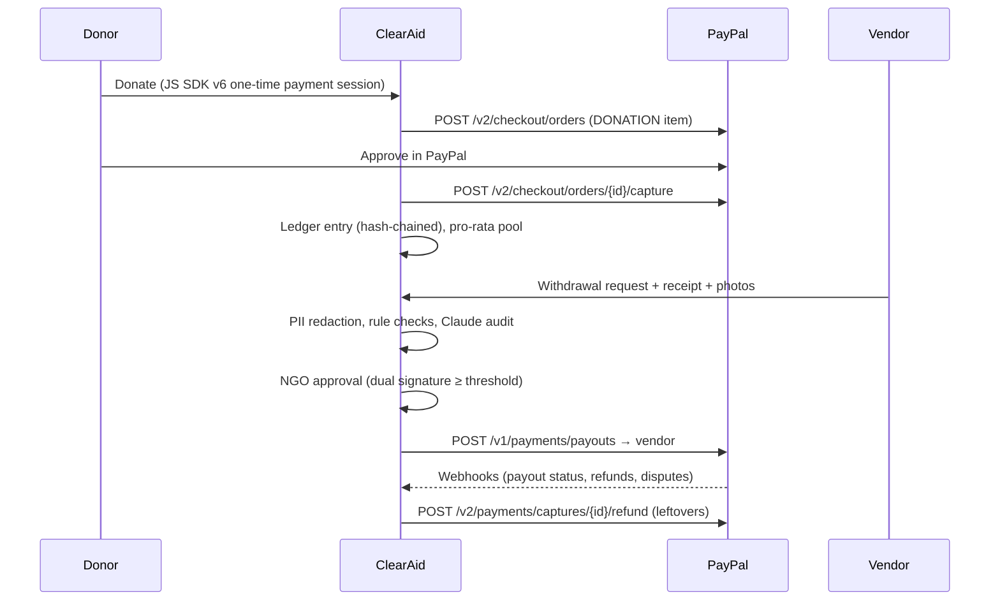

# ClearAid: transparent disaster relief on PayPal

**Every relief dollar, accounted for.** ClearAid gives NGOs dedicated disaster-relief funds on PayPal. Money can only leave a fund as a documented, AI-audited, human-approved PayPal payout to a verified vendor, and every movement is published on a public, hash-chained ledger. Donors can see who withdrew money, how much, and what it bought, down to their own share of each delivery. When the crisis ends, each donor chooses whether their unspent share is refunded or carried forward to another fund.

> Built for the PayPal AI Hackathon. The demo scenario (Cyclone Asha, Coastal Relief Collective and the rest) is fictional.

## Why it matters

Donors give less after disasters when they can't see where money goes, and NGOs spend a lot of staff time on reporting. ClearAid turns transparency from a quarterly PDF into a property of the payment system itself:

| Problem | ClearAid |
|---|---|
| "Did my money reach people?" | Follow-your-dollar: every payout is charged pro-rata to the donors whose money was in the fund at that moment, e.g. *"your $100 delivered ~1.8 food rations and ~21 jerrycans of water"* |
| Fake or inflated invoices | Claude reads every receipt and checks it against the request. Rule checks catch reused receipts, reused photos (perceptual hash), photos taken before the crisis or far from it, over-priced units and budget breaches |
| Beneficiary privacy | AI + regex PII redaction before anything is published; photos with identifiable people stay private |
| Leftover money | Pro-rata partial refunds through PayPal, or carry-forward to another fund, as each donor chooses |
| "Can I trust the dashboard?" | A SHA-256 hash-chained ledger that anyone can re-verify in their own browser with WebCrypto |

## Features

**For donors**
- PayPal JavaScript SDK v6 checkout (Orders v2, item category `DONATION`), anonymous by default
- Live fund page: money in vs out, spend by category against policy caps, needs progress, transparency score, live activity (server-sent events)
- **Crisis insights**: Claude writes a plain-language briefing from the ledger (what was achieved, what's still needed, integrity notes, runway)
- **Ask ClearAid**: a Claude agent with read-only tools over the public, redacted records ("Were any requests rejected? Why?")
- **My impact**: your exact share of every vendor payout, units delivered, and the refund / carry-forward choice when a fund closes
- Public AG Grid ledger with in-browser hash-chain verification and raw JSON export

**For vendors**
- Mobile-friendly request form: receipt plus delivery photos (camera capture), with capture time and GPS read from EXIF in the browser
- Client-side perceptual hash (dHash) and downscaling before upload
- "Generate sample receipt" and "Add synthetic test photo" buttons for demos; the AI should flag the synthetic photo

**For NGOs**
- Review queue with the AI audit summary, failed checks and signature count
- **Dual approval** above a threshold; approval triggers a **PayPal Payouts** batch to the vendor
- **AI fast lane**: clean, low-risk requests under a limit are paid without waiting (configurable per fund)
- **AI fund setup**: describe the crisis and Claude drafts needs, unit costs and spending caps for review
- Fund closure: start closing, then finalise, which issues pro-rata **partial capture refunds** and records carry-forwards
- **ClearAid Copilot**: Claude with ClearAid tools plus the official **PayPal Agent Toolkit** (`list_transactions`, `create_refund`, disputes, invoices, insights) and ledger-vs-PayPal reconciliation. Money-moving actions pause for human confirmation, and refunds are capped at the donor's unspent share.

## How the PayPal integration works



| PayPal capability | Where |
|---|---|
| JavaScript SDK v6 (`createInstance`, `createPayPalOneTimePaymentSession`, `<paypal-button>`) | `src/components/DonateBox.tsx` |
| Orders v2 create/capture | `src/lib/paypal.ts`, `src/app/api/paypal/orders/**` |
| Payouts | `sendVendorPayout` in `src/lib/paypal.ts`, called by `payWithdrawal` in `src/lib/funds.ts` |
| Partial capture refunds | `refundCapture` in `src/lib/paypal.ts`, called by `finalizeClosure` in `src/lib/funds.ts` |
| Webhooks + signature verification | `src/app/api/paypal/webhook/route.ts` (capture completed, refunds made outside ClearAid, payout item status, disputes) |
| Transaction search (reconciliation) | `listRecentTransactions` in `src/lib/paypal.ts` |
| PayPal Agent Toolkit | `src/lib/ai/agents.ts`: toolkit tool schemas adapted to Claude tool use |

**Production money flow.** In this hackathon build, donations settle in one PayPal business account and ClearAid's ledger keeps a sub-ledger per fund. For production we would onboard each NGO through PayPal Multiparty with delayed disbursement, so funds sit with PayPal until an approved withdrawal releases them.

## How the AI works

All Claude calls use the official Anthropic TypeScript SDK (`src/lib/ai/`). The default model is `claude-opus-5-5` (override with `CLAUDE_MODEL`). Server-side refusal fallbacks are enabled.

| Feature | Technique | File |
|---|---|---|
| PII redaction | Regex pass first (always runs), then Claude structured output | `src/lib/ai/redact.ts` |
| Withdrawal audit | Vision over receipt (image/PDF) and photos, plus request context and rule results, returned as a typed `AuditSchema` (risk, verdict, line items, per-photo findings) | `src/lib/ai/audit.ts` |
| Deterministic checks | Vendor verification, balance, limits, category caps, unit price vs need, duplicate receipt SHA-256, photo dHash Hamming distance, EXIF time and GPS distance | `src/lib/checks.ts` |
| Crisis insights / fund drafting | Structured outputs grounded only in ledger data | `src/lib/ai/insights.ts` |
| Ask ClearAid / Copilot | Tool-use agent loop; history kept server-side (tamper-proof); gated tools pause for confirmation | `src/lib/ai/agent.ts`, `src/lib/ai/agents.ts`, `src/lib/ai/tools.ts` |

The AI recommends and humans decide. A failed rule check can never be auto-approved, and every AI feature has a heuristic fallback, so the app runs end to end with no API keys.

## Run it

```bash
npm install
```

```bash
cp .env.example .env.local   # optional: add PayPal sandbox + Anthropic keys
```

```bash
npm run dev
```

Open http://localhost:3000 and use the persona menu (top right) to switch between public visitor, donors, NGO admins and vendors.

- **No keys:** "demo mode". PayPal calls are simulated (IDs prefixed `SIM-`) and AI features use heuristics. Everything is clearly labelled.
- **`PAYPAL_CLIENT_ID` / `PAYPAL_CLIENT_SECRET`:** real sandbox checkout, payouts and refunds. Use a sandbox business account with Payouts enabled, and give vendors sandbox personal-account emails.
- **`PAYPAL_WEBHOOK_ID`:** subscribe the webhook at `/api/paypal/webhook` to `PAYMENT.CAPTURE.*`, `PAYMENT.PAYOUTS-ITEM.*` and `CUSTOMER.DISPUTE.CREATED`.
- **`ANTHROPIC_API_KEY`:** Claude audits, redaction, insights, Ask ClearAid and Copilot.
- **`ZAPIER_WEBHOOK_URL`:** every ledger event is POSTed as JSON (fan out to Slack, SMS or Sheets).

Reset the demo any time from the persona menu ("Reset demo data").

### Deploy on Render

`render.yaml` is a one-click Blueprint. It builds with `npm ci && npm run build`, starts with `npm start`, and mounts a 1 GB disk at `/var/data` for the ledger and uploads. Set the secret env vars in the Render dashboard.

### API

`docs/ClearAid.postman_collection.json` covers every endpoint: funds, ledger, PayPal orders/capture, withdrawals, approvals, closure, Ask and Copilot.

## Project layout

```
src/lib/          domain logic (funds, ledger, checks, paypal, db, seed)
src/lib/ai/       Claude: redaction, audit, insights, agents, PayPal Agent Toolkit adapter
src/app/api/      route handlers
src/app/          pages: / (funds), /funds/[slug], /spend/[id], /me, /ngo, /vendor
src/components/   UI (DonateBox, Charts, LedgerGrid, Chat, …)
```

## Known limits (hackathon scope)

- Demo personas instead of real auth. Production would use Log in with PayPal for donors and SSO for NGO staff.
- JSON-file store on a single instance. Production would use Postgres; the ledger hash chain would be anchored periodically.
- Pro-rata attribution charges each payout to the money in the fund at that moment. Early donors' money is therefore spent first, and leftovers belong to the donors whose money is still unspent.
