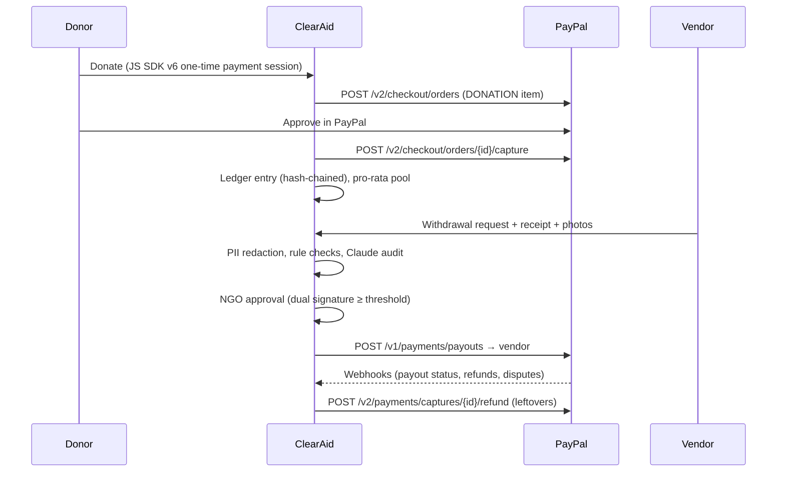

# ClearAid: financial controls for relief NGOs on PayPal

**Every relief dollar, accounted for.** ClearAid is a governance, risk and compliance (GRC) platform for NGOs running disaster-relief funds on PayPal. Staff see every dollar in and out on a tamper-evident ledger, payouts are AI-audited and need human sign-off from assigned approvers, and every action lands in a hash-chained audit log. It is an internal tool: only NGO staff sign in. The public sees a fund's donation link and whatever figures an admin chooses to publish as an embed, and nothing else.

> Built for the PayPal AI Hackathon. The demo scenario (Cyclone Asha, Coastal Relief Collective and the rest) is fictional.

## Why it matters

Relief NGOs move money fast under pressure, and auditors, boards and grant makers later ask who approved what, on what evidence. ClearAid makes those controls part of the payment system:

| Risk | Control in ClearAid |
|---|---|
| Fake or inflated invoices | Claude reads every receipt and checks it against the request. Rule checks catch reused receipts, reused photos (perceptual hash), photos taken before the crisis or far from it, over-priced units and budget breaches |
| One person moving money alone | Only people assigned to a fund can sign; large payouts need two different assigned approvers. Funds with fewer than two approvers are flagged |
| Unverified payees | Payouts go only to vendors an admin has verified (KYB) |
| Altered records | Each fund's ledger and the NGO-wide audit log are SHA-256 hash chains, re-verifiable in the browser |
| Beneficiary privacy | AI + regex PII redaction on request text; photos with identifiable people stay restricted |
| Publishing more than intended | Nothing is public by default. An admin picks, block by block, what a fund's embed shows and previews exactly that before it goes live; the public response is built from that list alone, so who gave, staff names, bank references, tracking codes and the audit log can't leak through it. Every change to an embed is audit-logged, and an embed can be paused or deleted at once |
| Personal data in bank statements | Every bank line is anonymised before it is stored: names of private individuals become stable aliases (`Person-3F9A2C`), and account numbers, phone numbers, emails and ID numbers are redacted. Fixed rules, no AI |

## Features

- **Overview**: cash position across funds, requests waiting for your signature, control status (dual-approval coverage, segregation of duties, ledger and audit-chain integrity, payee verification, evidence coverage, overhead caps, review timeliness), open risks, cash-flow chart and recent activity
- **Approvals**: review queue with the AI audit summary, failed checks and signatures; approval triggers a **PayPal Payouts** batch. **AI fast lane** pays clean, low-risk requests under a per-fund limit
- **Transactions**: every money movement across your funds (PayPal donations, staff-recorded bank transfers / cheques / grants, payouts, refunds, carry-forwards) with filters and CSV export. Staff can **record incoming money** received outside PayPal
- **Bank accounts**: add accounts for **CSV statement upload** (columns auto-detected, mapping remembered, duplicate files and rows skipped) or connect a bank with **Plaid** (Link + `/transactions/sync`; a simulated bank feed when no Plaid keys are set)
- **Tracking codes & Bank tagging**: each fund has one or more codes (e.g. `#RO1`, `#ASHA`); a bank line whose description carries one is tagged to that fund and posted to its ledger, optionally with a budget category (`#RO1-MED`). Lines with no code, an unknown code or codes for two funds wait in the **Bank tagging** queue, where staff tag, split, bulk-tag or retag them with a required reason. Bank fees stay in the general fund unless they carry a code. Tagging is rule-based only, never AI
- **Statement anonymisation**: lines from a CSV upload or a bank feed are anonymised on the way in, before they reach the database, a fund ledger or the audit log. A private person's name is replaced with an alias that stays the same for that person across lines (a keyed hash, so it can't be reversed by guessing), and account / card numbers, UPI handles, phone numbers, emails and ID numbers become placeholders such as `[ACCOUNT ••9301]`. Organisations, registered payees, tracking codes, amounts and the bank's own reference are kept, so the money trail still reads. The upload preview shows the rows as they will be stored (`backend/src/lib/anonymise.ts`)
- **Public embeds**: put a fund's figures on any website with an `<iframe>`. Under **Settings → Public embeds** an admin chooses what to publish (totals; money in by channel; spending by category; who was paid, either registered payees only or every payee; a money-flow diagram; money in and out over time; the latest ledger movements; a ledger integrity proof), sees a live preview of exactly what the public will get, and copies the code. The embed keeps itself up to date, fits its own height, works on phones, and can be paused (same link, shows a notice) or deleted. The same figures are available as JSON for sites that want to draw their own (`backend/src/lib/embed.ts`)
- **Audit log**: sign-ins (and failed attempts), signatures, rejections, payouts, access changes, team changes, fund setup, vendor changes, refunds, data exports and what was published in each embed, with filters, CSV export and in-browser chain verification
- **Funds & access**: who can approve each fund, join requests (approved by someone other than the requester), AI fund setup and fund closure with pro-rata **partial capture refunds** or carry-forwards
- **Team**: admins create logins, change roles, reset passwords (which signs the person out everywhere) and deactivate accounts
- **Copilot**: Claude with ClearAid tools plus the official **PayPal Agent Toolkit** and ledger-vs-PayPal reconciliation. Money-moving actions pause for confirmation, run as the signed-in person, and are audited

## How the PayPal integration works



| PayPal capability | Where |
|---|---|
| JavaScript SDK v6 (`createInstance`, `createPayPalOneTimePaymentSession`, `<paypal-button>`) | `src/components/DonateBox.tsx` |
| Orders v2 create/capture | `src/lib/paypal.ts`, `src/app/api/paypal/orders/**` |
| Payouts | `sendVendorPayout` in `src/lib/paypal.ts`, called by `payWithdrawal` in `src/lib/funds.ts` |
| Partial capture refunds | `refundCapture` in `src/lib/paypal.ts`, called by `finalizeClosure` in `src/lib/funds.ts` |
| Webhooks + signature verification | `src/app/api/paypal/webhook/route.ts` (capture completed, refunds made outside ClearAid, payout item status, disputes) |
| Transaction search (reconciliation) | `listRecentTransactions` in `src/lib/paypal.ts` |
| PayPal Agent Toolkit | `src/lib/ai/agents.ts`: toolkit tool schemas adapted to Claude tool use |

**Production money flow.** In this hackathon build, donations settle in one PayPal business account and ClearAid's ledger keeps a sub-ledger per fund. For production we would onboard each NGO through PayPal Multiparty with delayed disbursement, so funds sit with PayPal until an approved withdrawal releases them.

## How the AI works

All Claude calls use the official Anthropic TypeScript SDK (`src/lib/ai/`). The default model is `claude-opus-5-5` (override with `CLAUDE_MODEL`). Server-side refusal fallbacks are enabled.

| Feature | Technique | File |
|---|---|---|
| PII redaction | Regex pass first (always runs), then Claude structured output | `src/lib/ai/redact.ts` |
| Withdrawal audit | Vision over receipt (image/PDF) and photos, plus request context and rule results, returned as a typed `AuditSchema` (risk, verdict, line items, per-photo findings) | `src/lib/ai/audit.ts` |
| Deterministic checks | Vendor verification, balance, limits, category caps, unit price vs need, duplicate receipt SHA-256, photo dHash Hamming distance, EXIF time and GPS distance | `src/lib/checks.ts` |
| Crisis insights / fund drafting | Structured outputs grounded only in ledger data | `src/lib/ai/insights.ts` |
| Ask ClearAid / Copilot | Tool-use agent loop; history kept server-side (tamper-proof); gated tools pause for confirmation | `src/lib/ai/agent.ts`, `src/lib/ai/agents.ts`, `src/lib/ai/tools.ts` |

The AI recommends and humans decide. A failed rule check can never be auto-approved, and every AI feature has a heuristic fallback, so the app runs end to end with no API keys.

## How embedding works

An admin publishes an embed under **Settings → Public embeds** and pastes the generated code into the NGO's website:

```html
<iframe data-clearaid-embed src="https://your-clearaid.example/embed/KEY" title="Cyclone Asha: where the money goes" loading="lazy" style="width:100%;max-width:760px;height:640px;border:0"></iframe>
<script async src="https://your-clearaid.example/embed.js"></script>
```

- The `<iframe>` alone is enough. The optional script only resizes the frame to fit: the embed posts its height to the host page, and the script applies it to frames that came from the same ClearAid site. It reads nothing from the host page.
- `/embed/KEY` needs no sign-in, doesn't use cookies, and calls one endpoint, `GET /api/embed/KEY`, which returns only the blocks switched on for that embed (CORS is open, since the data is public and no credentials are involved). A paused, deleted or unknown key returns the same 404.
- Amounts are totals from the fund's ledger; dates are to the day. Who gave, bank references, account names, tracking codes, staff names, approvals, receipts and the audit log are never part of the response, and a bank payment's own wording appears only if the admin chose "Name every payee" (`backend/src/lib/embed.test.ts` checks this against the whole demo data set).

## Run it

The app is two services: `backend/` (Hono API on port 4000) and `frontend/` (Next.js on port 3000, which proxies `/api/*` to the backend; set `BACKEND_URL` to point elsewhere).

```bash
cd backend && npm install && npm run dev
```

```bash
cd frontend && npm install && npm run dev
```

Optionally copy `backend/.env.example` to `backend/.env` and add PayPal sandbox and Anthropic keys. `npm test` in `backend/` runs the statement-anonymisation and public-embed tests.

Open http://localhost:3000 and sign in. There are no donor accounts, and everything is behind sign-in except two kinds of page: a fund's donation link (`/give/<fund>`) and the embeds an admin has published (`/embed/<key>`). Passwords are scrypt-hashed and the session cookie is HMAC-signed (set `SESSION_SECRET` in production). The demo logins are listed on the sign-in page:

| Username | Password | Role |
| --- | --- | --- |
| `priya` | `admin-demo` | Admin: full audit log, team and access management, funds and vendors |
| `daniel` | `user-demo` | Staff: assigned to all three funds |
| `meera` | `user-demo` | Staff: no funds yet, has a pending request to join Monsoon Preparedness |

Staff see only the funds they're assigned to (and the audit entries for those funds plus their own actions). Admins see everything.

- **No keys:** "demo mode". PayPal calls are simulated (IDs prefixed `SIM-`) and AI features use heuristics. Everything is clearly labelled.
- **`PAYPAL_CLIENT_ID` / `PAYPAL_CLIENT_SECRET`:** real sandbox payouts and refunds. Use a sandbox business account with Payouts enabled, and give vendors sandbox personal-account emails.
- **`PAYPAL_WEBHOOK_ID`:** subscribe the webhook at `/api/paypal/webhook` to `PAYMENT.CAPTURE.*`, `PAYMENT.PAYOUTS-ITEM.*` and `CUSTOMER.DISPUTE.CREATED`.
- **`PLAID_CLIENT_ID` / `PLAID_SECRET` / `PLAID_ENV`:** real Plaid (sandbox by default) on the Bank accounts page; try Plaid's sandbox user `user_good` / `pass_good`. Without them, "Connect bank" adds a simulated feed. Access tokens are stored AES-256-GCM encrypted.
- **`ANTHROPIC_API_KEY`:** Claude audits, redaction, insights and Copilot.
- **`ZAPIER_WEBHOOK_URL`:** every ledger event is POSTed as JSON (fan out to Slack, SMS or Sheets).

Admins can reset the demo from the sidebar ("Reset demo data").

## Project layout

```
backend/src/lib/          domain logic (funds, ledger, audit log, banking, anonymise, embed, checks, paypal, session, seed)
backend/src/lib/ai/       Claude: redaction, audit, insights, agents, PayPal Agent Toolkit adapter
backend/src/routes/       API routes (auth, overview, transactions, audit, funds, withdrawals, ngo/*, embeds; public: give/*, embed/*)
frontend/src/app/         pages: / (money flow), /transactions, /untagged, /funds, /funds/[slug] (fund trail), /sources, /audit, /settings, /copilot; public: /give/[slug] (donation link), /embed/[key] (published figures)
frontend/src/components/  AppShell, console (sign-in, queue, access, team, vendors), Embeds (admin) and EmbedView (the public widget), charts, grids
frontend/public/embed.js   optional helper that fits an embed's height on the host page
```

## Known limits (hackathon scope)

- Username/password only. Production would add SSO and MFA.
- JSON-file store on a single instance. Production would use Postgres, and anchor the ledger and audit-log hash heads externally.
- No payment-request intake screen yet: `POST /api/withdrawals` accepts requests from assigned staff (with `vendorId`), but the demo relies on seeded requests.
- Bank money is tracked per fund but isn't tied to a PayPal donor, so fund closure refunds or carries forward only PayPal donations; bank money left in a closed fund stays on its ledger. Bank lines are USD only, and Plaid `modified`/`removed` updates aren't applied (pending lines are skipped instead).
- Statement anonymisation is rule-based. A person's name is recognised in the payee / payer column, or in the description after a payment rail (`NEFT CR Kavya Menon …`), a role word (`beneficiary …`) or a title (`Dr. …`); a name written elsewhere in free text is not. In the payee column, a business with no telling word in its name (Ltd, Traders, Foundation…) that isn't a registered payee is treated as a person. Lines imported before this was added keep their original text, because ledger entries can't be rewritten; "Reset demo data" reseeds the demo anonymised.
- A sample statement for the demo is in `docs/sample-bank-statement.csv`.
- `render.yaml` still describes the earlier single-service layout.
- Public embeds are public: the key in an embed's link only keeps it from being found by guessing, so anyone who has the link (or views the page it is on) can read what it shows. "Name every payee" publishes a bank payment's own wording for payees that aren't registered, so check the preview before using it. Embeds are per fund; there is no organisation-wide embed yet.

## Future scope

- **Donor transparency**: let donors see where their money went and choose what to do with any leftover amount after the crisis (refund it, or carry it forward to another fund). The ledger already attributes every payout pro-rata to the donations that funded it and can refund or carry forward leftovers at fund closure; what is missing is a donor sign-in and the screens for it.
- **AI recommendations for what to publish**: an AI recommendation engine that suggests to the aid admin which data to make public for each fund (for example which embed blocks to switch on), with the admin still making the final choice.
