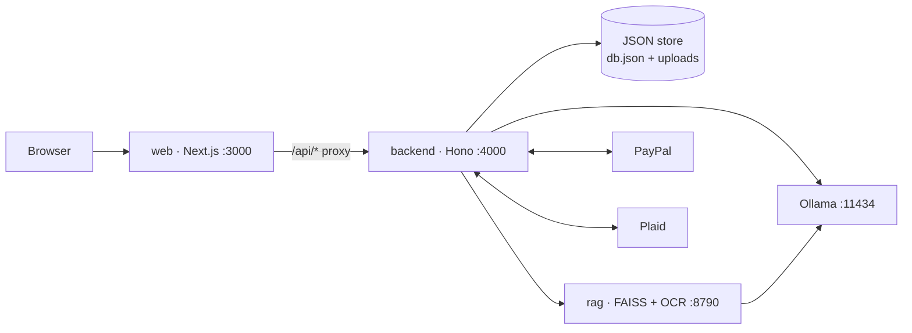
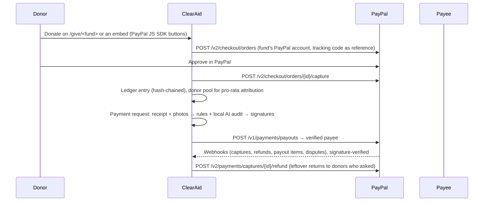

# ClearAid: Financial Controls for Relief NGOs on PayPal

**Every relief dollar, accounted for.** ClearAid is a governance, risk and compliance (GRC) tool for NGOs running disaster-relief funds on PayPal. It traces every dollar from where it came from (PayPal gifts, bank transfers, grants), to the fund it belongs to, to who it was paid to, and keeps the evidence with it. Money movements sit on a tamper-evident ledger per fund. Payments are checked by fixed rules and a local AI model and signed by people. Every action lands in a hash-chained audit log.

It's an internal tool: only NGO staff (and read-only donor logins an admin creates) sign in. The public sees a fund's donation page and whatever figures an admin chooses to publish as an embed, and nothing else. **All AI runs locally** (Ollama + FAISS): no donor, beneficiary or bank data goes to a cloud AI service.

> Built for the PayPal AI Hackathon. The demo scenario (Cyclone Asha, Coastal Relief Collective and everyone in it) is fictional.

**Documentation:** [Business requirements (BRD)](docs/BRD.md) · [High-level design (HLD)](docs/HLD.md) · [Low-level design (LLD)](docs/LLD.md) · [Demo recording script](docs/DEMO_SCRIPT.md) · [Postman collection](docs/postman/README.md)

---

## Contents

- [Why it matters](#why-it-matters)
- [Features](#features)
- [Architecture](#architecture)
- [Quick start](#quick-start)
- [Setting up the .env files](#setting-up-the-env-files)
- [Configuration](#configuration)
- [Run it in Docker](#run-it-in-docker)
- [How the PayPal integration works](#how-the-paypal-integration-works)
- [Connecting banks with Plaid](#connecting-banks-with-plaid)
- [How the AI works](#how-the-ai-works)
- [How embedding works](#how-embedding-works)
- [AG Grid, Postman and Render](#ag-grid-postman-and-render)
- [Testing](#testing)
- [Project layout](#project-layout)
- [Troubleshooting](#troubleshooting)
- [Known limits](#known-limits)
- [Future scope](#future-scope)

## Why it matters

Relief NGOs move money fast under pressure, and auditors, boards and grant makers later ask who approved what, on what evidence. ClearAid builds those controls into the way money is recorded:

| Risk | Control in ClearAid |
|---|---|
| Money that can't be tied to an appeal | Every fund has tracking codes (`#RO1`, `#ASHA-MED`). Bank lines and PayPal gifts carrying one are traced automatically; everything else waits in one **Untagged** queue with the reason |
| Fake or inflated invoices | A local AI model reads every receipt. Rule checks catch reused receipts, reused photos (perceptual hash), photos taken before the crisis or far from it, over-priced units and budget breaches |
| One person moving money alone | Only people assigned to a fund can sign its payments; large ones need two different approvers. Large manual tags and every retag need a second person. Funds with fewer than two approvers are flagged |
| Unverified payees | Payouts go only to payees an admin has verified |
| Altered records | Each fund's ledger and the NGO-wide audit log are SHA-256 hash chains, re-verifiable in the browser |
| Personal data in bank statements | Every bank line is anonymised **before it is stored**: private individuals become stable aliases (`Person-3F9A2C`); account numbers, UPI IDs, phones, emails and ID numbers are redacted. Fixed rules, no AI |
| Beneficiary privacy | Regex + local AI redaction of request text; photos with identifiable people stay private |
| Publishing more than intended | Nothing is public by default. An admin picks, block by block, what an embed shows and previews exactly that. The public response is built from that list alone, so donors, staff names, bank references and the audit log can't leak through it |

## Features

The app has eight screens. Donor logins see only Money flow, Transactions, Funds and Copilot, for the funds an admin assigned them, in redacted form.

| Screen | What it does |
|---|---|
| **Money flow** | Money in, money out, still held and not yet traced; a source → fund → destination diagram (by category or by payee); biggest sources and payees; money in vs out over time; latest movements |
| **Transactions** | Every movement across your funds (PayPal gifts, bank lines, money recorded by staff, payments, payouts, refunds, carry-forwards) with filters, a *Missing documents* filter and CSV export. **Record payment** reads a receipt with the local AI and pre-fills the form. **Record incoming** logs cheques, cash and grants. **Pay via PayPal** sends a payout from a fund. Click any row to add your own tags or attach an invoice or receipt that arrived later. **Evidence →** opens a payment's AI audit |
| **Untagged** | Bank lines that couldn't be traced to exactly one fund (no code, unknown code, codes for two funds). Tag, split, bulk-tag or retag them with a required reason. Tags at or above the threshold, and every retag, wait under *Waiting for approval* for a second person. Also tabs for missing receipts, bank fees and PayPal transfers |
| **Funds** | Each fund's flow, sources and payees, donation link, embed shortcut, money in vs out, spending by category, and its hash-chained **ledger** with **Verify hash chain**. Admins close funds here and decide where the leftover goes |
| **Sources** | PayPal accounts (keys, **Connect with PayPal** partner onboarding, or simulated) with a reconciliation of collected, refunded, paid out, moved to the bank and still in PayPal. Bank accounts by **CSV statement upload** (columns auto-detected, preview of the anonymised rows, duplicates skipped) or **Plaid** (simulated feed without keys). Fee rules and PayPal links per bank account |
| **Audit log** | Sign-ins (and failed attempts), tags and approvals, payments, payouts, access and team changes, fund setup, payee changes, refunds, exports and embed changes, with filters, CSV export and **Verify chain** |
| **Settings** | **Team** (logins, roles, password resets that sign the person out everywhere, deactivation, donor fund access, *Can send PayPal payments*), **Fund access** (assignments and join requests approved by someone else), **Funds & tracking codes** (including AI fund drafting and each fund's PayPal account), **Controls** (tag sign-off threshold, receipt threshold, bank-fee policy), **Payees** (register and verify), **Public embeds** |
| **Copilot** | Ask in plain language where money came from and went. A local Llama 3.1 8B answers from a FAISS index of every record plus exact totals from the ledger, and cites the records. Access is enforced before search: admins ask about every fund, staff about their funds, donors about their assigned funds (redacted) |

**Payment requests and AI audit.** A payee's payment request carries the receipt and proof-of-delivery photos. Deterministic rules plus a local vision model score it, and its page (`/spend/<id>`) shows the risk score, every check, the receipt as read, the evidence and the signatures. Approval releases a **PayPal payout**. The **AI fast lane** may pay clean, low-risk requests under a per-fund limit; a failed rule check can never be auto-approved.

**Recording a payment from its receipt.** Upload a receipt or invoice. It's read on this machine (OCR, then the local model) for supplier, invoice number, date, total, line items and any tracking code printed on it. The person checks it (changes are noted in the audit log) and it's posted to the fund's ledger. A bank transfer, card or cheque payment then waits for its bank line: a line with the same amount from 3 days before to 21 days after the receipt date is **matched** to it instead of being counted again. Payments can be unlinked or voided with a reason (`backend/src/lib/payments.ts`).

**PayPal money reaching the bank.** Link each bank account to the PayPal accounts that withdraw into it. Deposits that read like a PayPal transfer are then marked as **transfers**: they never go on a fund (the money was counted when the gifts came in) and have their own tab on Untagged (`backend/src/lib/transfers.ts`).

**Fund closure and leftover money.** An admin starts closing a fund (new money stops), moves any part of the leftover to other open funds (unspent PayPal gifts move with it pro-rata, so donors can follow their share), and closes it. Whatever isn't moved stays held and tracked on the closed fund. If the fund allows it, donors who ticked *return my share* when they gave get `leftover × (their gifts ÷ raised)` back, as a PayPal refund (gifts under 180 days old) or a payout (`backend/src/lib/returns.ts`).

## Architecture



- **web** (`frontend/`): Next.js 16, React 19, Tailwind 4, AG Grid and AG Charts. It proxies `/api/*` to the backend (`BACKEND_URL`).
- **backend** (`backend/`): Hono on Node 22, TypeScript and Zod. It holds every business rule, both hash chains, the auth gate, PayPal and Plaid, and the AI orchestration. Data is one JSON file with atomic writes.
- **rag** (`rag/`): a Python service for FAISS search (Copilot) and OCR (receipts).
- **Ollama**: local models `llama3.1:8b`, `nomic-embed-text` and `llava`.

Details: [HLD](docs/HLD.md) (components, flows, security, deployment) and [LLD](docs/LLD.md) (data model, algorithms, API reference, configuration).

## Quick start

**You need:** [Node.js 22+](https://nodejs.org) and [Git](https://git-scm.com). For the AI features you also need [Ollama](https://ollama.com/download) and Python 3.10+.

```bash
git clone https://github.com/Shreyro/ClearAid.git
```

```bash
cd ClearAid
```

**1. Start the API** (port 4000), in its own terminal:

```bash
cd backend && npm install && npm run dev
```

**2. Start the web UI** (port 3000), in a second terminal:

```bash
cd frontend && npm install && npm run dev
```

**3. Open http://localhost:3000** and click one of the demo logins:

| Username | Password | Role |
| --- | --- | --- |
| `priya` | `admin-demo` | Admin: everything, including team, access, funds, payees, sources and embeds |
| `daniel` | `user-demo` | Staff: assigned to all three funds |
| `meera` | `user-demo` | Staff: no funds yet, has a pending request to join Monsoon Preparedness |
| `maya` | `donor-demo` | Donor (read-only): sees the Cyclone Asha fund, redacted |

That's enough to use the whole app in **demo mode**: PayPal and the bank feed are simulated (IDs start with `SIM-`) and AI features use non-AI fallbacks, all clearly labelled. Admins can **Reset demo data** from the bottom of the sidebar.

**4. Turn on the local AI** (Copilot, receipt reading, AI audits). Install Ollama from https://ollama.com/download. It's a desktop program; `pip install ollama` only installs the Python library and won't give you the `ollama` command. Then pull the models:

```bash
ollama pull llama3.1:8b && ollama pull nomic-embed-text && ollama pull llava
```

Start the search and OCR service in a third terminal (it listens on `127.0.0.1:8790`; the backend fills its index automatically):

```bash
pip install -r rag/requirements.txt
```

```bash
python rag/server.py
```

Without Ollama or the rag service the rest of the app still works; the Copilot page says what's missing (and falls back to keyword search if only FAISS is down).

**5. Optional: real PayPal and Plaid sandboxes.** Copy `backend/.env.example` to `backend/.env`, add the keys (see [Configuration](#configuration)), and restart the backend.

**6. Optional: the demo NGO website** that shows embeds on a separate site (port 5500). Test it locally with the command below; it is not deployed on Render. See [`demo-site/README.md`](demo-site/README.md).

```bash
python -m http.server 5500 --directory demo-site
```

To record a demo, follow [docs/DEMO_SCRIPT.md](docs/DEMO_SCRIPT.md).

## Setting up the .env files

ClearAid reads settings from environment files. **Never commit them**: `.env` is in `.gitignore`, and it holds your PayPal and Plaid secrets.

| File | Used by | Template |
|---|---|---|
| `backend/.env` | The API when you run it with `npm run dev` | `backend/.env.example` |
| `.env` (project root) | `docker compose` (ports, models, secrets shared by the containers) | `.env.example` |
| `.env.sandbox-accounts` (project root) | Only the `npm run sandbox:data` script | create it by hand (see below) |

**1. Create the file from its template.**

```bash
# macOS / Linux / Git Bash
cp backend/.env.example backend/.env
```

```powershell
# Windows PowerShell
Copy-Item backend\.env.example backend\.env
```

For Docker, copy the root `.env.example` to `.env` the same way. Lines starting with `#` are comments; remove the `#` to turn an optional setting on. Restart the backend after any change.

**2. Run with nothing filled in (demo mode).** Leave every key blank and the app still works with simulated PayPal and banks. Only fill in what you want to make real.

**3. PayPal sandbox** (optional).
1. Sign in at https://developer.paypal.com/dashboard, switch to **Sandbox**, and open **Apps & Credentials**.
2. Open (or create) a REST app and copy its **Client ID** and **Secret** into `PAYPAL_CLIENT_ID` and `PAYPAL_CLIENT_SECRET`. Keep `PAYPAL_ENV=sandbox`.
3. For webhooks, open the same app, scroll to **Sandbox Webhooks → Add Webhook**, enter `<your public address>/api/paypal/webhook` and subscribe to the events (or **All Events**). PayPal then shows a **Webhook ID**: put it in `PAYPAL_WEBHOOK_ID`. Without it, webhook signatures can't be checked. PayPal cannot reach `localhost`, so use a tunnel (for example Cloudflare or ngrok) when testing locally.

**4. Plaid sandbox** (optional).
1. At https://dashboard.plaid.com/developers/keys copy the **Client ID** and the **Sandbox secret** into `PLAID_CLIENT_ID` and `PLAID_SECRET`. Keep `PLAID_ENV=sandbox`.
2. In the sandbox, sign in to any bank with `user_good` / `pass_good`.
3. For banks that log in on their own website, set `PLAID_REDIRECT_URI` to `<your public address>/oauth/plaid` **and** add exactly the same URL under **Developers → API → Allowed redirect URIs** in the Plaid dashboard (Plaid asks you to verify your identity before it saves). If you skip the dashboard step, "Connect with Plaid" fails with *OAuth redirect URI must be configured in the developer dashboard*.

**5. Secrets and URLs.**
- `SESSION_SECRET`: a long random value, for example `openssl rand -hex 32`. It signs sign-in cookies and encrypts the stored PayPal and bank keys, so **keep it fixed**: changing it signs everyone out and makes saved keys unreadable. If empty, one is generated and stored in the data folder.
- `APP_URL` (backend) and `PUBLIC_URL` (Docker): the address people use to reach the web UI, `http://localhost:3000` by default. PayPal return links use it.
- `RAG_TOKEN`: any shared secret, set to the same value for the API and `rag/server.py`.

**6. Local AI** (optional). The defaults work once Ollama is installed and the models are pulled (see [Quick start](#quick-start)). `LOCAL_AI=off` switches to the non-AI fallbacks.

**7. Deploying on Render.** `render.yaml` marks the PayPal and Plaid keys, `PAYPAL_WEBHOOK_ID` and `PLAID_REDIRECT_URI` as `sync: false`, so they are **not** copied from git. Enter them under the service's **Environment** tab in the Render dashboard. Set `RENDER_MODE=YES` to switch the AI features off on the hosted copy. Use the web service's address (for example `https://<your-web>.onrender.com/oauth/plaid`) for the Plaid redirect URI.

**8. Optional: `.env.sandbox-accounts`** (root). Only `npm run sandbox:data` reads it. It holds the US sandbox business account's keys as `NGO_CLIENT_ID`, `NGO_CLIENT_SECRET` and `NGO_MERCHANT_EMAIL`. Do not commit it.

**Check it worked.** Open **Sources**: a PayPal account card shows your client ID's first characters, and "Connect with Plaid" opens the Plaid window without an error.

## Configuration

Backend settings go in `backend/.env` (template: `backend/.env.example`). Docker settings go in `.env` at the root (template: `.env.example`). The full list is in [LLD §9](docs/LLD.md#9-configuration).

| Variables | Effect |
|---|---|
| *(none)* | Demo mode: simulated PayPal and bank feed, non-AI fallbacks if Ollama isn't running |
| `PAYPAL_CLIENT_ID`, `PAYPAL_CLIENT_SECRET`, `PAYPAL_ENV` | The NGO's **main** PayPal account (sandbox by default): real orders, captures, payouts and refunds. Use a sandbox business account with Payouts enabled. More accounts (one per appeal or office) are added on **Sources → PayPal accounts** with their own REST keys, checked with PayPal and stored AES-256-GCM encrypted; each fund's donation page pays into the account chosen under **Settings → Funds** |
| `PAYPAL_WEBHOOK_ID` | Verifies PayPal webhooks at `/api/paypal/webhook`. Subscribe to `PAYMENT.CAPTURE.*`, `PAYMENT.PAYOUTS-ITEM.*` and `CUSTOMER.DISPUTE.CREATED`. Accounts added on Sources use `/api/paypal/webhook?account=<id>` with their own webhook ID |
| `PAYPAL_PARTNER_CLIENT_ID`, `PAYPAL_PARTNER_CLIENT_SECRET`, `PAYPAL_PARTNER_MERCHANT_ID`, `PAYPAL_PARTNER_WEBHOOK_ID` | ClearAid's PayPal partner (platform) app. Enables **Connect with PayPal**: the NGO logs in to PayPal and grants ClearAid permission to take payments and refund for that account (Partner Referrals); no NGO keys are stored. PayPal doesn't let a partner send payouts from someone else's account, so returns by payout from those accounts are flagged to do by hand. Webhooks: `/api/paypal/webhook?account=partner`. Live use needs PayPal's Multiparty approval |
| `PLAID_CLIENT_ID`, `PLAID_SECRET`, `PLAID_ENV` | Real Plaid on **Sources** (sandbox by default; sandbox login `user_good` / `pass_good`). Access tokens are stored AES-256-GCM encrypted. See [Connecting banks with Plaid](#connecting-banks-with-plaid) |
| `COPILOT_MODEL`, `LOCAL_VISION_MODEL`, `OLLAMA_URL`, `LOCAL_AI` | Local AI (defaults `llama3.1:8b`, `llava` for images only, `http://127.0.0.1:11434`, on). `LOCAL_AI=off` uses the non-AI fallbacks everywhere |
| `RAG_URL`, `RAG_TOKEN` | The search/OCR service (default `http://127.0.0.1:8790`, no token). Set the same `RAG_TOKEN` for `rag/server.py` if other users share the machine |
| `SESSION_SECRET` | Signs sign-in cookies and derives the key that encrypts stored PayPal and bank secrets. Set a long random value in production and keep it fixed; otherwise one is generated and stored in the data folder |
| `DATA_DIR`, `PORT`, `APP_URL` | Data folder (default `.data`), API port (4000), and the public URL used in PayPal return links |
| `ALLOW_DEMO_RESET=false` | Turns off **Reset demo data** |

Everything is behind sign-in except a fund's donation page (`/give/<fund>`) and published embeds (`/embed/<key>`). Passwords are scrypt-hashed and the session cookie is HMAC-signed.

**Data from the sandboxes only.** `cd backend && npm run sandbox:data` resets the app to a clean start (the NGO, logins, funds with their codes, and payees, with no transactions). It then adds the NGO's US sandbox PayPal business account from `../.env.sandbox-accounts`, gives test-card donations that are real captures in the PayPal sandbox, and connects dummy Plaid sandbox banks whose operations account receives withdrawals of that PayPal balance. Every transaction then exists in PayPal's or Plaid's sandbox.

## Run it in Docker

`docker-compose.yml` starts the whole stack: web UI, API, the FAISS/OCR service and Ollama, each restarting on failure and starting in order.

```bash
cp .env.example .env
```

```bash
cp backend/.env.example backend/.env
```

```bash
docker compose up -d --build
```

Open http://localhost:3000. Only the web UI is published; the API, rag and Ollama talk on a private network, and the UI proxies `/api/*` to the API (so PayPal webhooks go to `<PUBLIC_URL>/api/paypal/webhook`).

| Service | Image | Keeps its data in |
| --- | --- | --- |
| `web` | `frontend/Dockerfile` (Next.js standalone build) | n/a |
| `backend` | `backend/Dockerfile` | volume `clearaid-data`: `db.json`, uploads, the session secret |
| `rag` | `rag/Dockerfile` | volume `clearaid-rag`: FAISS indexes and the embedding cache |
| `ollama` | `ollama/ollama` | volume `clearaid-models`: the models (profile `ollama`) |
| `models-embed`, `models-chat`, `models-vision` | `ollama/ollama` | one-shot jobs that pull `nomic-embed-text`, `llama3.1:8b` and `llava` (profile `ollama`) |
| `tunnel` | `cloudflare/cloudflared` | n/a (profile `tunnel`: a public HTTPS address) |

The first start downloads about 5 GB of models. The app works straight away; the Copilot answers once `docker compose logs -f models-chat` shows the pull has finished. Llama needs about 6 GB of memory for containers. On a Linux host with an NVIDIA GPU, uncomment the `deploy` block under `ollama` for much faster answers. `COMPOSE_PROFILES` in `.env` picks the optional parts. Without `ollama`, set `OLLAMA_URL=http://host.docker.internal:11434` to use an Ollama already running on the host.

**Production-like on one machine:** `node scripts/prod-local.mjs` creates `.env` with fixed random secrets, uses the host's Ollama if one is running, starts a Cloudflare quick tunnel, and writes its HTTPS address into `PUBLIC_URL`, `PLAID_REDIRECT_URI` and `PLAID_WEBHOOK_URL`. It then builds and starts the stack and waits until it's healthy. A quick tunnel gets a new address on every start, so run the script again after a restart and update the URLs it prints in the Plaid and PayPal dashboards. `node scripts/prod-local.mjs --down` stops it.

**Render:** `render.yaml` deploys `clearaid-api` and `clearaid-web` with `RENDER_MODE=YES`, which turns every AI feature and the Copilot off (the Copilot page is hidden and `/api/copilot*` answers 403). The AI runs only when you run the code on your own machine, where `RENDER_MODE` is unset or `NO` (the default).

For production, set a long random `SESSION_SECRET` and `RAG_TOKEN` (`openssl rand -hex 32`), set `PUBLIC_URL` to the address people use, and serve over HTTPS. Back up the `clearaid-data` volume; the other two can be rebuilt. `docker compose down` stops everything and keeps the data (`-v` deletes it).

## How the PayPal integration works



| PayPal capability | Where |
|---|---|
| JavaScript SDK buttons | `frontend/src/components/DonateForm.tsx` |
| Orders v2 create / capture | `createDonationOrder`, `captureDonationOrder` in `backend/src/lib/paypal.ts`; routes `backend/src/routes/give/[slug]/order` and `/capture` |
| Payouts | `sendVendorPayout` (called by `payWithdrawal` in `backend/src/lib/funds.ts`) and `sendPayout` (**Pay via PayPal**, `backend/src/lib/paypal-pay.ts`; donor returns) |
| Capture refunds | `refundCapture`, used for leftover returns (`backend/src/lib/returns.ts`) |
| Webhooks + signature verification | `verifyWebhook` in `paypal.ts`; `backend/src/routes/paypal/webhook/route.ts` |
| Partner Referrals (connect by login) | `backend/src/lib/paypal-partner.ts`, return page `frontend/src/app/paypal/connected` |
| Transaction search (reconciliation) | `listRecentTransactions` in `paypal.ts` |

**Production money flow.** In this build, donations settle in the NGO's PayPal account(s) and ClearAid keeps a sub-ledger per fund. For production we would onboard each NGO through PayPal Multiparty with delayed disbursement, so funds stay with PayPal until an approved payment releases them.

## Connecting banks with Plaid

An admin presses **Connect with Plaid** on **Sources** and logs in to the NGO's bank in Plaid's own window; ClearAid never sees the bank password. Every account the bank login shares (checking, savings…) becomes its own ClearAid account, and they sync together. The first sync brings in up to two years of history (`PLAID_HISTORY_DAYS`). After that:

- **Plaid's webhook** (`PLAID_WEBHOOK_URL` → `/api/plaid/webhook`) says when new transactions are ready, and ClearAid pulls them at once. Only webhooks signed by Plaid are accepted (ES256 JWT, body hash, 5-minute window).
- **A timer** syncs every connected bank every `PLAID_SYNC_MINUTES` (default 60) as a fallback, and **Sync all banks** does it on demand.
- **Expired logins** are flagged on Sources, in the audit log and from Plaid's ITEM webhooks. **Log in again** opens Link in update mode, keeping the account's history.
- **Banks that log in on their own website** (OAuth) return to `/oauth/plaid`. Set `PLAID_REDIRECT_URI` to that page's URL and add it to the Plaid dashboard.

In the Plaid sandbox, `npm run plaid:sandbox-banks -- --paypal main` (in `backend/`) adds matching PayPal withdrawals to a dummy bank and links the two. To host it: get production access in the Plaid dashboard, set `PLAID_ENV=production`, serve over HTTPS, and set `PLAID_REDIRECT_URI` and `PLAID_WEBHOOK_URL`. `PLAID_COUNTRY_CODES` widens Link beyond US banks. Only USD, posted transactions are imported.

## How the AI works

All AI runs locally through Ollama. Every feature uses the Copilot's model (`COPILOT_MODEL`, default `llama3.1:8b`), which Ollama keeps loaded between calls; outputs are constrained to a JSON schema and validated before use (`backend/src/lib/ai/local.ts`). Only images that aren't text (delivery photos) need a model that can see: `LOCAL_VISION_MODEL` (default `llava`).

| Feature | Technique | File |
|---|---|---|
| Receipt reading | OCR in `rag/` (EasyOCR for photos and scans, with lines rebuilt and tilt corrected; a PDF's own text layer), then the local model → fields; fixed rules take the tracking code only from the printed text and sanity-check dates and totals | `rag/ocr.py`, `backend/src/lib/ai/ocr.ts`, `backend/src/lib/ai/receipt.ts` |
| PII redaction | Regex pass first (always runs), then the local model's structured output | `backend/src/lib/ai/redact.ts` |
| Payment-request audit | Local vision model over receipt and photos, plus request context and rule results → typed risk, verdict, line items and per-photo findings | `backend/src/lib/ai/audit.ts` |
| Deterministic checks | Payee verification, balance, limits, category caps, unit price vs need, duplicate receipt SHA-256, photo dHash distance, EXIF time and GPS distance | `backend/src/lib/checks.ts` |
| Fund insights / fund drafting | Structured outputs grounded only in ledger data | `backend/src/lib/ai/insights.ts` |
| Copilot | FAISS search (`nomic-embed-text`) plus a keyword pass over only the indexes the person may read, exact per-fund totals, Llama 3.1 8B. One index per fund and audience (`staff` / redacted `public`) | `backend/src/lib/rag/`, `rag/server.py` |

The AI recommends and people decide. A failed rule check can never be auto-approved, tracing and anonymisation never use AI, and every AI feature has a non-AI fallback, so the app runs end to end without Ollama (or with `LOCAL_AI=off`).

## How embedding works

An admin builds an embed under **Settings → Public embeds**: one fund, several funds added together, or "All funds" (including ones created later); light, dark or "match the visitor's device"; and which blocks to publish (totals; money in by channel; spending by category; who was paid, registered payees only or every payee; a money-flow diagram; money in and out over time; the latest ledger movements; a ledger integrity proof; a PayPal donate form). A live preview shows exactly what the public will get. **Get code** gives:

```html
<iframe data-clearaid-embed src="https://your-clearaid.example/embed/KEY" title="Cyclone Asha: where the money goes" loading="lazy" style="width:100%;max-width:760px;height:640px;border:0"></iframe>
<script async src="https://your-clearaid.example/embed.js"></script>
```

- The `<iframe>` alone is enough. The optional script only resizes the frame: the embed posts its height to the host page, and the script applies it to frames from the same ClearAid site. It reads nothing from the host page.
- `/embed/KEY` needs no sign-in, uses no cookies, and calls one endpoint, `GET /api/embed/KEY`, which returns only the blocks switched on (CORS is open; the data is public). Paused, deleted and unknown keys all return the same 404. The same JSON is available to sites that want to draw their own.
- Amounts are totals from the ledger, and dates are to the day. Donors, bank references, account names, staff names, approvals, receipts and the audit log are never part of the response. Tracking codes appear only with the donate form, and a bank payment's own wording only if the admin chose "Name every payee". `backend/src/lib/embed.test.ts` checks this against the whole demo data set.
- Every embed change is audit-logged, and an embed can be paused (same link, shows a notice) or deleted at once.

## AG Grid, Postman and Render

**AG Grid and AG Charts (the data views).** Every table in the web UI is an [AG Grid](https://www.ag-grid.com/) grid, and the charts are [AG Charts](https://www.ag-grid.com/charts/). `frontend/src/components/DataGrid.tsx` wraps AG Grid for the card-sized tables (funds, sources, payees), and `LedgerGrid.tsx` sets the shared theme and shows the ledger and audit log. The Transactions and Audit log pages use them directly, so sorting, column sizing and copying cells work the same everywhere. `Charts.tsx` draws the charts, such as *Money in vs money out*. The money-flow Sankey diagram is ClearAid's own component, not AG Charts.

**Postman (API testing).** `docs/postman/ClearAid.postman_collection.json` holds 392 requests in 13 folders that cover every backend route, with 1,595 assertions: status codes, access rules, hash-chain re-computation, anonymisation, maker-checker, PayPal accounts and public embeds. Newman runs it from the command line, and the last run (all passed) is saved as `docs/postman/report.html`. To use it in the Postman app, import the collection, set the `baseUrl` variable, and point Postman's working directory at `docs/postman/` so the upload requests find the sample receipts. Full steps are in [`docs/postman/README.md`](docs/postman/README.md).

**Render (hosting).** The deployed copy runs on [Render](https://render.com/), defined by `render.yaml`:

| Service | Link | What it is |
|---|---|---|
| Web UI | https://clearaid-web.onrender.com | The Next.js app (`frontend/`) |
| API | https://clearaid-api.onrender.com | The Hono backend (`backend/`), health check at `/healthz` |

The API runs from the Docker image in `backend/` with a persistent disk (`clearaid-data`, mounted at `/data`) that holds the JSON data store. It deploys on every push to `main`, and the PayPal and Plaid keys are entered in the Render dashboard (see [Setting up the .env files](#setting-up-the-env-files)).
> **The AI features are switched off on Render** (`RENDER_MODE=YES`). The Copilot, receipt and photo reading, and the AI audits and drafting need a local Ollama model and the `rag` service, which the hosted copy doesn't run. The rest of the app works normally. To use the AI features, run ClearAid on your own machine (see [Quick start](#quick-start)).

## Testing

```bash
cd backend && npm test
```

79 unit tests cover anonymisation, embed privacy (over the full demo data), PayPal accounts and partner onboarding, Pay via PayPal, PayPal transfers, bank sync, declared payments and entry metadata, donor returns, fund closure, Copilot scope and chats, and OCR post-processing. Type checks: `npm run typecheck` in `backend/` and `frontend/`; lint: `npm run lint` in `frontend/`. A Postman collection that exercises every API route, with sample receipts and its last report, is in [`docs/postman/`](docs/postman/README.md).

## Project layout

```
backend/src/server.ts       route table, sign-in gate, donor allowlist, background jobs
backend/src/routes/         API routes, one route.ts per path (see LLD §7 for the full list)
backend/src/lib/            domain logic: funds, ledger, audit log, banking, anonymise, payments,
                            transfers, returns, embed, checks, paypal*, plaid, bank-sync, session, seed
backend/src/lib/ai/         local AI: Ollama wrapper, OCR, receipt, audit, redaction, insights
backend/src/lib/rag/        Copilot: documents, access scope, retrieval, chat history
backend/scripts/            sandbox-data, plaid-sandbox-banks, seed-transactions
frontend/src/app/           pages: / (money flow), /transactions, /untagged, /funds, /funds/[slug],
                            /spend/[id], /sources, /audit, /settings, /copilot;
                            public: /give/[slug], /embed/[key]
frontend/src/components/    AppShell, console (sign-in, team, access, payees), banking, Embeds,
                            EmbedView, RecordPayment, PayPalPayout, EntryPanel, Charts, Sankey, LedgerGrid
frontend/public/embed.js    optional helper that fits an embed's height on the host page
rag/                        FAISS search + OCR service (Python)
ai/                         Render image: Ollama + rag in one container
demo-site/                  static demo NGO website showing embeds
docs/                       BRD, HLD, LLD, demo script, Postman collection, sample files
scripts/prod-local.mjs      production-like Docker stack with a public HTTPS tunnel
docker-compose.yml          the whole stack in containers
render.yaml                 Render blueprint
```

## Troubleshooting

| Problem | Fix |
|---|---|
| Windows: `An Application Control policy has blocked this file … next-swc… .node` / "Turbopack is not supported on this platform" | Windows (Smart App Control, or a company policy) is blocking the compiled helper files Next.js and Tailwind ship. On a personal PC turn off **Windows Security → App & browser control → Smart App Control**, delete `frontend/node_modules` and `frontend/.next`, and run `npm install` again. Otherwise run ClearAid in **WSL** (clone it inside the Linux home folder, not under `/mnt/c`) or with **Docker**. `next dev --webpack` won't help, because Tailwind's compiled files would be blocked too |
| `'ollama' is not recognized` | Install the Ollama app from https://ollama.com/download (or `winget install Ollama.Ollama`), then open a new terminal. `pip install ollama` is only the Python library |
| Copilot says **partly offline** | Start Ollama and `python rag/server.py`, and pull the models listed in [Quick start](#quick-start) |
| `npm audit` warnings after install | Safe to ignore for local use. Don't run `npm audit fix --force`; it can upgrade packages to versions that break the app |
| Signed out after restarting the backend | Set a fixed `SESSION_SECRET`, or keep the generated `DATA_DIR/session-secret` file |
| "This file was already imported" | The same statement can't be imported twice; **Reset demo data** to start over |

## Known limits

- Username and password only. Production would add SSO and MFA.
- JSON-file store on a single instance. Production would use Postgres and anchor the ledger and audit-log hash heads externally.
- No screen lists payment requests that are **waiting** for signatures (`/approvals` redirects to Money flow). Paid and rejected requests open from **Transactions → Evidence →**; a pending one opens at `/spend/<id>` (IDs from `/api/withdrawals?status=pending_approval`). No intake screen for new requests either: `POST /api/withdrawals` accepts them from assigned staff, and the demo uses seeded requests.
- The live-update stream (`/api/stream`) isn't filtered by fund access yet, so a signed-in session listening to it can receive live ledger entries of funds it can't open (see [LLD §12](docs/LLD.md#12-known-technical-gaps)).
- Bank money is tracked per fund but isn't tied to a PayPal donor. When leftover money moves at closure, unspent PayPal gifts move with it pro-rata and anything above that is untied bank money. Bank lines are USD only, and Plaid `modified`/`removed` updates aren't applied (pending lines are skipped instead).
- Statement anonymisation is rule-based. A person's name is recognised in the payee/payer column, or in the description after a payment rail (`NEFT CR Kavya Menon …`), a role word (`beneficiary …`) or a title (`Dr. …`); a name elsewhere in free text is not. In the payee column, a business with no telling word in its name (Ltd, Traders, Foundation…) that isn't a registered payee is treated as a person.
- Public embeds are public: the key in an embed's link only stops it being found by guessing. "Name every payee" publishes a bank payment's own wording for payees that aren't registered, so check the preview first.
- A sample statement for the demo is in `docs/sample-bank-statement.csv`, and sample receipts are in `docs/postman/`.

## Future scope

- **PayPal Multiparty with delayed disbursement** per NGO, so money stays with PayPal until an approved payment releases it.
- **Approvals inbox and vendor portal**: a queue of requests waiting for your signature, and a portal where payees submit requests with their receipts and photos.
- **AI recommendations for what to publish**: suggest which embed blocks to switch on for each fund, with the admin still deciding.
- **Donor choice at closure**: let donors pick refund or carry-forward for their share themselves (today they opt in to a return when giving, and an admin decides where the rest goes).
- **SSO / MFA, Postgres and external anchoring** of chain heads.
