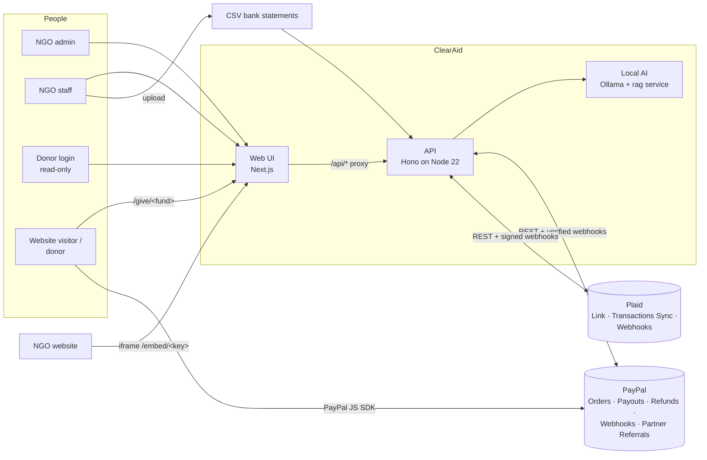
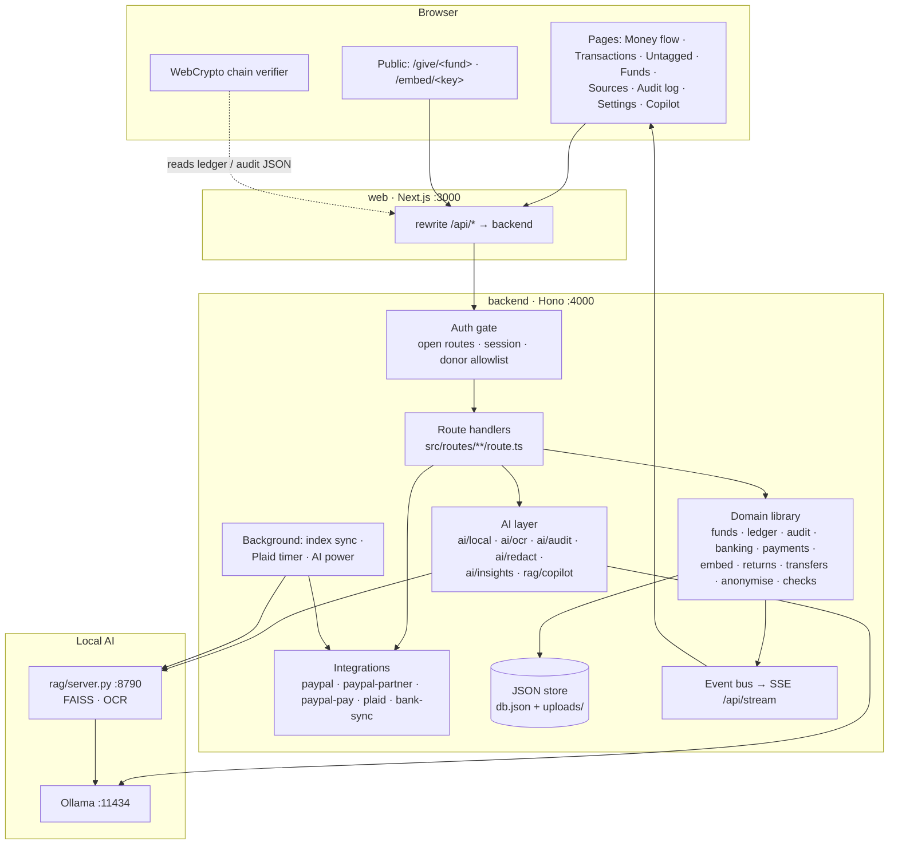
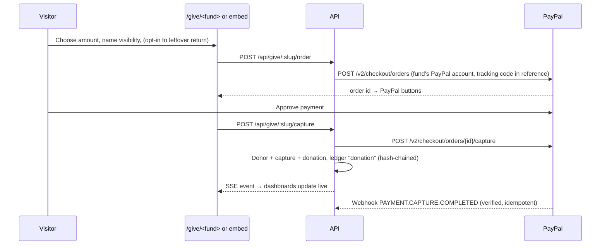
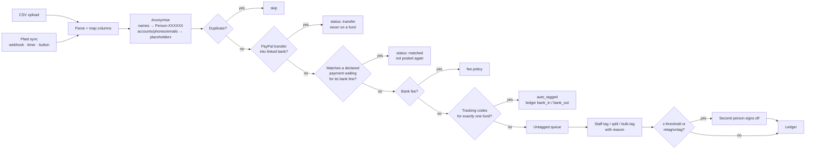
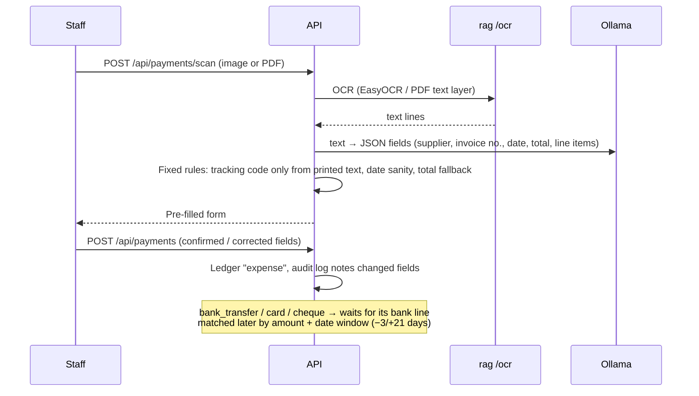
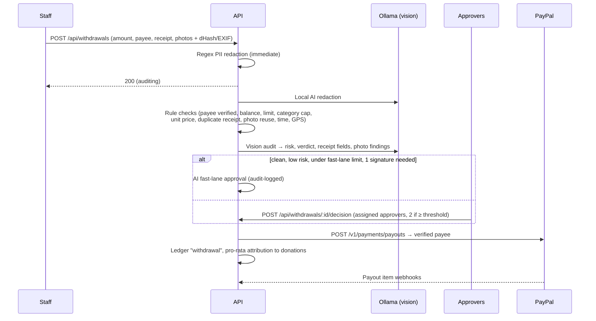
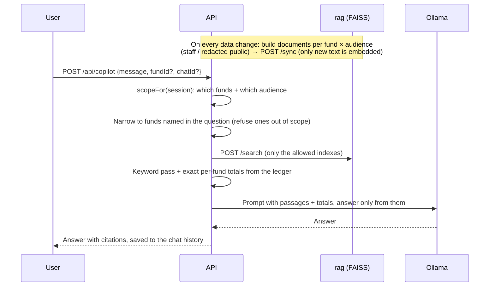
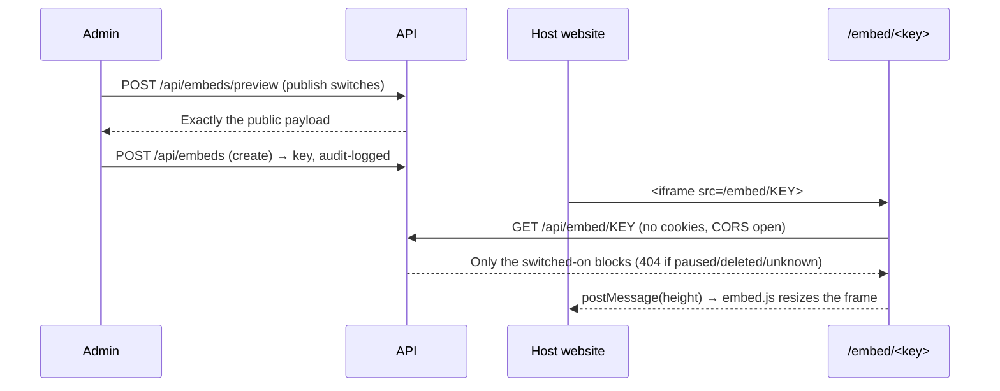

# ClearAid: High-Level Design (HLD)

| | |
|---|---|
| Document | High-Level Design |
| Version | 1.0 (matches `main`) |
| Related | [BRD](BRD.md) · [Low-Level Design](LLD.md) · [Demo script](DEMO_SCRIPT.md) |

---

## 1. Purpose

This document describes ClearAid's architecture: the components, how they talk to each other and to PayPal, Plaid and the local AI, how data flows through the system, and the main design decisions. Module internals, data structures, algorithms and the API are in the [LLD](LLD.md).

## 2. System context



**Actors**

- **Admins and staff** run the NGO's finances in the web UI.
- **Donor logins** are read-only and see only the funds an admin assigned them, in redacted form.
- **Visitors** see only two kinds of page without signing in: a fund's donation page (`/give/<fund>`) and embeds an admin has published (`/embed/<key>`).
- **PayPal** takes donations, sends payouts and refunds, and notifies ClearAid by webhook.
- **Plaid** connects bank accounts and pushes "new transactions ready" webhooks.

## 3. Architecture overview

ClearAid has three runtime services and one optional piece:

| Service | Tech | Port | Responsibility |
|---|---|---|---|
| **web** | Next.js 16 (App Router, React 19, Tailwind 4, AG Grid, AG Charts) | 3000 | All screens; proxies `/api/*` to the API so the browser uses one origin and one cookie |
| **backend (API)** | Hono on Node 22, TypeScript, Zod | 4000 | Business logic, auth, ledger and audit chains, PayPal/Plaid integration, AI orchestration, JSON store, server-sent events |
| **rag** | Python 3 (standard-library HTTP server), FAISS, NumPy, EasyOCR, PyMuPDF | 8790 | Vector search for the Copilot (`/sync`, `/search`) and OCR of receipts (`/ocr`) |
| **ollama** | Ollama | 11434 | Local models: `llama3.1:8b` (chat and structured outputs), `nomic-embed-text` (embeddings), `llava` (images only) |
| *tunnel* (optional) | Cloudflare quick tunnel | n/a | A public HTTPS address for PayPal/Plaid webhooks and OAuth redirects on a local machine |



### 3.1 Layers inside the API

1. **Gate** (`src/server.ts`). Every route is classed as open (sign-in, donation pages, published embeds, webhooks) or protected. Protected routes need a valid NGO session. Donor sessions are checked against an explicit allowlist of method + path pairs, so any new route is closed to donors by default.
2. **Route handlers** (`src/routes/**/route.ts`). These are thin: they parse input, check fund-level access, call the domain library and shape the response.
3. **Domain library** (`src/lib/*`). This holds all rules: ledger and audit appends, tagging, matching, attribution, closure, returns, embeds, anonymisation and rule checks. Changes go through one `mutate()` call that persists atomically.
4. **AI layer** (`src/lib/ai/*`, `src/lib/rag/*`). Calls Ollama with JSON-schema-constrained outputs, validates them with Zod, and always has a non-AI fallback.
5. **Integrations** (`paypal*.ts`, `plaid.ts`, `bank-sync.ts`). Each runs live with keys, or simulated without them (IDs prefixed `SIM-`).

## 4. Key flows

### 4.1 Donation via PayPal



### 4.2 Bank money: import, trace, tag



### 4.3 Recording a payment from its receipt



### 4.4 Payment request audit and approval



### 4.5 Copilot (local retrieval-augmented answers)



### 4.6 Public embed



## 5. Data architecture

- **Store.** One JSON document (`DATA_DIR/db.json`) plus an `uploads/` folder for receipts, photos and documents. It is loaded once into memory. Every change runs through `mutate(fn)`, which writes a temp file and renames it (an atomic write) and then notifies listeners (Copilot index sync, SSE).
- **Concurrency.** Single process. Money-moving async work (payouts, returns) is serialised per fund with `withLock("fund:<id>")`, so balances can't race.
- **Main entities.** NGO and members, funds (policy, needs, codes, viewers), donors, captures, donations, payees (vendors), files, withdrawals, ledger entries, audit entries, bank accounts, statement imports, bank lines, declared payments, PayPal accounts, embeds, donor returns, transaction tags and metadata, Copilot chats. See the [LLD data model](LLD.md#3-data-model).
- **Immutability.** Ledger and audit entries are append-only hash chains. Corrections are new entries (reversals, voids, retags). Tags and documents added later live beside the ledger (`entryMeta`), never inside it.
- **Money.** Integer cents (USD). Pro-rata splits use the largest-remainder method so parts always add up exactly.
- **AI indexes.** FAISS `IndexFlatIP` over L2-normalised `nomic-embed-text` vectors, one index per fund and audience, kept on disk by the rag service, plus an embedding cache keyed by text hash.

## 6. Security architecture

| Concern | Design |
|---|---|
| Authentication | Username + password (scrypt). Cookie `clearaid_persona = ngo:<memberId>:<HMAC>`, signed with `SESSION_SECRET` over the member id and password-change time, so a password reset signs the person out everywhere. `Secure` when served over HTTPS |
| Authorisation | Gate in `server.ts` (open routes, NGO session, donor allowlist), then fund-level checks in handlers (`requireFundAccess`, `isAssigned`, admin-only actions) |
| Segregation of duties | Join requests approved by someone else; dual approval of payment requests; second-person sign-off on large manual tags and every retag; the same person can't sign twice |
| Secrets at rest | PayPal REST secrets and Plaid access tokens are AES-256-GCM encrypted with a key derived from the session secret and never sent to the browser |
| Webhooks | PayPal: `verify-webhook-signature` per account (or the partner app), with processed IDs stored for idempotency. Plaid: ES256 JWT, body SHA-256 and a 5-minute window |
| Privacy | Bank lines anonymised before storage (keyed-hash aliases); payment-request text redacted (regex + local AI); photos with faces kept private; AI is local only |
| Publishing | Embed responses are built from a whitelist of blocks. Donor, staff, bank-reference and audit data are never included (covered by `embed.test.ts` over the whole demo data set). Unknown, paused and deleted keys all return the same 404 |
| Tamper evidence | SHA-256 hash chains for each fund's ledger and the NGO audit log, re-verified in the browser with WebCrypto |
| Internal service auth | Optional shared `RAG_TOKEN` between the API and the rag service. In Docker only the web UI is published; the API, rag and Ollama sit on a private network |

## 7. Deployment views

### 7.1 Local development

```
Browser ─► Next.js dev :3000 ─► Hono API :4000 ─► rag/server.py :8790 ─► Ollama :11434
                                     └─► .data/db.json, .data/uploads/
```

### 7.2 Docker Compose (`docker-compose.yml`)

| Service | Profile | Network | Volume |
|---|---|---|---|
| `web` | always | edge + internal, port `WEB_PORT` published | none |
| `backend` | always | internal | `clearaid-data` (db.json, uploads, session secret) |
| `rag` | always | internal | `clearaid-rag` (FAISS indexes, embedding cache) |
| `ollama`, `models-embed`, `models-chat`, `models-vision` | `ollama` | internal | `clearaid-models` |
| `tunnel` | `tunnel` | edge | none |

`scripts/prod-local.mjs` sets up a production-like stack on one machine: it writes fixed random secrets, reuses a host Ollama if one is running, opens a Cloudflare quick tunnel and fills in `PUBLIC_URL`, `PLAID_REDIRECT_URI` and `PLAID_WEBHOOK_URL`.

### 7.3 Render (`render.yaml`)

- `clearaid-api`: Docker web service with a persistent disk for the data.
- `clearaid-web`: the Next.js web service.
- `clearaid-ai`: a private service (`ai/Dockerfile`, `ai/start.sh`) running Ollama plus the rag/OCR service on an 8 GB instance (llama3.2:3b) with a model disk. The API suspends it after `AI_IDLE_MINUTES` without use and resumes it on the next AI request (`lib/ai-power.ts`, using the Render API).

## 8. Operating modes

| Mode | Trigger | Behaviour |
|---|---|---|
| Demo / simulated PayPal | No `PAYPAL_CLIENT_ID` and `PAYPAL_CLIENT_SECRET` | Orders, captures, payouts and refunds are simulated (`SIM-` IDs) and labelled in the UI |
| Live PayPal (sandbox or live) | Keys set, `PAYPAL_ENV` | Real PayPal REST calls and webhooks |
| Partner onboarding | `PAYPAL_PARTNER_*` set | "Connect with PayPal": NGOs grant permissions by logging in. Payments go to that merchant and refunds are made on its behalf |
| Simulated bank feed | No Plaid keys | "Connect bank" adds a simulated feed |
| Live Plaid | `PLAID_CLIENT_ID`, `PLAID_SECRET`, `PLAID_ENV` | Plaid Link, `/transactions/sync`, webhooks, re-login handling |
| AI on | Ollama reachable, `LOCAL_AI` not `off` | Local model for every AI feature |
| AI off / unreachable | `LOCAL_AI=off` or Ollama down | Heuristic fallbacks; Copilot falls back to keyword search if only FAISS is down |
| Clean sandbox data | `npm run sandbox:data` | Resets to NGO, logins, funds and payees only, then fills the app from real PayPal and Plaid sandbox transactions |

## 9. Design decisions

| Decision | Rationale | Trade-off |
|---|---|---|
| Hash-chained, append-only ledger and audit log | Tamper evidence that anyone can verify without trusting the server | Corrections are extra entries; history grows |
| Rule-based tracing and anonymisation (no AI) | Deterministic, explainable, testable; money allocation must never be guessed | Free-text names outside known patterns aren't caught |
| Local AI only (Ollama + FAISS) | Beneficiary, donor and bank data never leave the NGO; no per-call cost | Needs about 6 GB RAM; slower without a GPU |
| AI recommends, humans decide | Accountability stays with people; failed rules block auto-approval | Some manual work remains |
| Embeds built from a whitelist | Publishing can't leak fields by accident when the data model grows | New public fields need explicit work |
| Donor allowlist in the gate | New routes are closed to donors by default | Each donor-visible route must be added explicitly |
| JSON file store | Zero setup for the hackathon; atomic writes | Single instance; production needs Postgres |
| Separate API and web services | Clear boundary; the UI proxies `/api/*` so cookies stay same-origin | Two processes to run |
| Simulated modes for every integration | The demo runs anywhere without keys | Simulated data must be clearly labelled (it is) |

## 10. Constraints and known limits

See the [README](../README.md#known-limits) and [BRD §8](BRD.md#8-assumptions-and-constraints). In short: one NGO per deployment, USD only, a single-instance store, username and password only, and rule-based anonymisation limited to known patterns.
