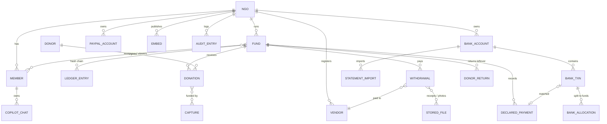

# ClearAid: Low-Level Design (LLD)

| | |
|---|---|
| Document | Low-Level Design |
| Version | 1.0 (matches `main`) |
| Related | [BRD](BRD.md) · [High-Level Design](HLD.md) · [Demo script](DEMO_SCRIPT.md) |

This document goes one level below the [HLD](HLD.md): code layout, data model, storage, the algorithms behind each control, the API surface, configuration and tests. File paths are relative to the repository root.

---

## 1. Repository layout

```
backend/                     Hono API (Node 22, TypeScript, ESM)
  src/server.ts              Route table, auth gate, donor allowlist, background jobs
  src/routes/**/route.ts     One module per path; exports GET and/or POST handlers
  src/lib/                   Domain logic (see §2)
  src/lib/ai/                Local AI: ollama wrapper, OCR, receipt, audit, redact, insights
  src/lib/rag/               Copilot: documents, scope, retrieval, chats
  scripts/                   sandbox-data, plaid-sandbox-banks, seed-transactions
frontend/                    Next.js 16 App Router (React 19, Tailwind 4, AG Grid/Charts)
  src/app/                   Pages (see §8)
  src/components/            AppShell, console, banking, Embeds, EmbedView, Charts, Sankey, …
  public/embed.js            Optional iframe auto-height helper for host pages
rag/                         Python retrieval + OCR service (FAISS, EasyOCR, PyMuPDF)
ai/                          Render image: Ollama + rag in one container
demo-site/                   Static fictional NGO website showing embeds (port 5500)
docs/                        BRD, HLD, LLD, demo script, Postman collection, samples
scripts/prod-local.mjs       Production-like Docker stack + Cloudflare tunnel on one machine
docker-compose.yml           Full stack in containers
render.yaml                  Render blueprint (api, web, private ai)
```

## 2. Backend modules

| Module | Responsibility |
|---|---|
| `lib/config.ts` | Reads environment variables (PayPal, partner app, Plaid, data dir, local AI, Render power management) |
| `lib/db.ts` | JSON store: `getDb`, `mutate`, `withLock`, `resetDb(demo\|clean)`, migrations, `newId`, `onDbChange` |
| `lib/types.ts` | All entity types (§3) |
| `lib/session.ts` | Signed cookie, `getSession`, `requireNgo`, `requireAdmin`, `requireFundAccess`, `isAssigned`, `canViewFund`, `ngoCanSeeFund`, `actorOf` |
| `lib/password.ts` | scrypt hash/verify |
| `lib/ledger.ts` | Per-fund hash chain: `canonical`, `appendLedger`, `verifyChain` |
| `lib/audit.ts` | NGO-wide audit chain: `canonicalAudit`, `audit`, `verifyAuditChain` |
| `lib/money.ts` | Integer cents helpers, `fmt`, `splitProRata` (largest remainder) |
| `lib/funds.ts` | `fundStats`, `recordDonation`, `attribute`, `requiredApprovals`, `payWithdrawal`, closure (`startClosure`, `moveLeftover`, `finalizeClosure`, `closurePreview`) |
| `lib/withdrawals.ts` | `decideWithdrawal` (sign/reject, dual approval, triggers payout) |
| `lib/checks.ts` | Deterministic payment-request rules + `rulesRisk` |
| `lib/banking.ts` | Tracking-code parsing, `ingestRows` (dedupe → transfer → payment match → fee → code), tagging, split, retag, second-person sign-off |
| `lib/csv.ts` | CSV parser, column auto-detection, date/amount parsing |
| `lib/anonymise.ts` | Rule-based bank-line anonymisation (aliases + redaction) |
| `lib/payments.ts` | Declared payments: post, match to bank line, unlink, void |
| `lib/transfers.ts` | PayPal-to-bank transfer detection and PayPal account reconciliation |
| `lib/entry-meta.ts` | Staff tags and later documents on ledger entries |
| `lib/paypal.ts` | PayPal REST: credentials check, orders, capture, refunds, payouts, webhook verification, transaction search |
| `lib/paypal-accounts.ts` | Multiple PayPal accounts (env default, keyed, partner, simulated), `fundConn` |
| `lib/paypal-partner.ts` | Partner Referrals onboarding, merchant status |
| `lib/paypal-pay.ts` | "Pay via PayPal" from a fund (permission, balance and cap checks, payout return handling) |
| `lib/plaid.ts` | Link tokens, token exchange, `/transactions/sync`, webhook JWT verification, AES-GCM token sealing, simulated feed |
| `lib/bank-sync.ts` | Per-item sync across accounts, health/reconnect flags, timer (`startAutoSync`) |
| `lib/returns.ts` | Leftover returns to donors who asked (plan, send, webhook reversal) |
| `lib/embed.ts` | Embed publish switches, payload builders, public lookup |
| `lib/flow.ts` | Source → fund → destination flow (Sankey) data |
| `lib/movements.ts`, `lib/views.ts` | Ledger/withdrawal/fund view models for the UI |
| `lib/events.ts` | In-process event bus feeding `/api/stream` (SSE) |
| `lib/uploads.ts` | File storage with SHA-256 |
| `lib/ai-power.ts` | Suspend/resume the hosted AI service via the Render API |
| `lib/seed*.ts` | Demo scenario (NGO, 4 logins, 3 funds, payees, donations, requests, bank lines, PayPal accounts, audit history) |

## 3. Data model

All money is **integer cents (USD)**. IDs are `<prefix>_<12 hex>` (`newId`). Timestamps are ISO-8601 strings.



### 3.1 Key entities (abridged; full definitions in `backend/src/lib/types.ts`)

| Entity | Important fields |
|---|---|
| `NgoMember` | `id, name, title, username, passwordHash (scrypt salt:hash), role: admin\|user\|donor, active, passwordChangedAt?, canPay?` |
| `NgoControls` | `tagApprovalThreshold`, `receiptThreshold`, `feePolicy {mode: unallocated\|fund, fundId?, category?}` |
| `Fund` | `id, slug, title, region, lat/lng, startedAt, goal, status: active\|closing\|closed, policy, needs[], vendorIds[], assignees[], viewers[], trackingCodes[], paypalAccountId?, donorReturns?, returnBase?` |
| `FundPolicy` | `categoryCaps (% of raised), dualApprovalThreshold, maxSingleWithdrawal, requirePhotos, fastLaneMax, fastLaneMaxRisk` |
| `Donation` | `fundId, donorId, amount, source: paypal\|carry_forward, captureIds[], attributed, refunded, carriedOut, returned?, returnOptIn?` |
| `Capture` | PayPal capture: `orderId, accountId?, amount, refunded, live, payerEmail?` |
| `Withdrawal` | Payment request: `vendorId, amount, category, needId?, quantity?, purposeRaw (private), purposePublic (redacted), piiFound[], receiptFileIds[], photoFileIds[], status: auditing\|pending_approval\|paid\|rejected\|payout_failed, audit?, approvals[], payout?, attribution[]` |
| `AuditResult` | `engine: local\|heuristic, riskScore 0–100, verdict: approve\|needs_review\|reject, summary, receipt?, photos[], checks[]` |
| `StoredFile` | `kind: receipt\|photo, mime, sha256, dhash? (64-bit hex), exif? {takenAt, lat, lng}, public, scan?` |
| `LedgerEntry` | `seq, fundId, ts, type, amount (±cents, 0 for notices), memo, actor, ref?, paypalRef?, prevHash, hash` |
| `AuditEntry` | `seq, ts, actorId, actorName, action, fundId?, targetId?, summary, meta?, prevHash, hash` |
| `BankAccount` | `provider: csv\|plaid, institution, mask?, csvMapping?, feePatterns[], transfersFrom[], plaid? {itemId, accessTokenEnc, cursor, accountId, health, simulated}` |
| `BankTxn` | `accountId, dedupeKey, date, amount, description (anonymised), counterparty?, anonymised[], isFee, status: auto_tagged\|tagged\|untagged\|fee_unallocated\|matched\|transfer, allocations[], untaggedReason?, pending?, receipts[], paymentId?, transfer?, history[]` |
| `BankAllocation` | `fundId, category?, amount (positive), code?` |
| `PendingTag` | `kind: tag\|retag\|untag, allocations, reason, byId, why` |
| `DeclaredPayment` | Money out recorded from a receipt: method (`bank_transfer\|card\|cheque\|cash\|other\|paypal`), status (`awaiting_bank\|matched\|no_bank\|void`), receipt file, linked bank line |
| `PayPalAccount` | `mode: live\|partner\|simulated, env, clientId?, clientSecretEnc?, merchantId?, webhookId?, status` |
| `PublicEmbed` | `key (16 random bytes, base64url), fundId \| "all", fundIds?, theme, name, publish: EmbedPublish, enabled` |
| `EmbedPublish` | `totals, sources, categories, payees: off\|registered\|all, flow, timeline, activity: 0\|5\|10\|25, integrity, funds, donate?` |
| `DonorReturn` | `fundId, donorId, accountId?, amount, method: refund\|payout, status: sent\|completed\|unclaimed\|returned\|failed, parts[]` |
| `TxnTag` / `EntryMeta` | Staff tags and documents keyed by `"<fundId>:<seq>"`; never inside the ledger |
| `CopilotChat` | Per-user conversation history |

### 3.2 Ledger entry types

`fund_opened`, `donation`, `bank_in`, `bank_out`, `expense` (declared payment), `withdrawal` (PayPal payout), `withdrawal_rejected` (notice), `refund`, `refund_reversed`, `carry_forward_out`, `carry_forward_in`, `dispute_opened`, `fund_closing`, `fund_closed`.

## 4. Storage and concurrency

- `load()` reads `DATA_DIR/db.json` once into a process-global holder. A missing or old-version file is replaced with the demo seed (`DB_VERSION = 7`). Small forward migrations run on load (demo donor, donor fund assignment, extra demo accounts).
- `mutate(fn)` runs `fn(db)` synchronously, then `persist` (write `db.json.<pid>.tmp`, then `rename`), then calls `onDbChange` listeners. The audit entry for a change is written **inside the same `mutate`**, so a change and its audit record are saved together.
- `withLock(key, fn)` chains promises per key. Payouts and returns lock `fund:<id>` so two payouts can't both pass the same balance check.
- Uploads are stored under `DATA_DIR/uploads/<fileId>`, with the SHA-256 recorded for duplicate detection.
- `resetDb("demo")` reseeds. `resetDb("clean")` keeps the NGO, logins, funds (re-opened, with codes and needs) and payees, and drops everything else. Each fund then starts with a `fund_opened` entry.

## 5. Security implementation

### 5.1 Session and gate

```
cookie  clearaid_persona = "ngo:<memberId>:<base64url HMAC-SHA256(secret, "ngo:<memberId>:<passwordChangedAt>")>"
secret  SESSION_SECRET, or a random 32 bytes persisted at DATA_DIR/session-secret (mode 600)
```

`server.ts` registers every `[path, module]` pair for GET and POST and wraps each handler in `requestContext.run(req)` (AsyncLocalStorage, so library code can read cookies). For each request:

1. If the path is in `OPEN_ROUTES` (`/api/auth/*`, `/api/session`, `/api/config`, PayPal and Plaid webhooks, `/api/give/:slug[/order|/capture]`, `/api/embed/:key`), run the handler.
2. Otherwise require `session.role === "ngo"`, or return **401**.
3. If `memberRole === "donor"` and `"<METHOD> <path>"` is not in `DONOR_ROUTES`, return **403** "Donor logins are read-only".
4. The handler then applies fund-level checks: `requireFundAccess(fundId)` (admin, or assigned staff), `isAssigned(fund, memberId)` for signing, and `requireAdmin()` for settings, closure, embeds and team changes.

### 5.2 Secrets and webhooks

- `encryptToken`/`decryptToken`: AES-256-GCM, 12-byte IV, stored as `iv.tag.ciphertext` (base64url), with the key derived from the session secret. Used for Plaid access tokens and PayPal client secrets.
- PayPal webhooks (`routes/paypal/webhook`): choose the account (`?account=<id>`, `partner`, or the default), call PayPal `verify-webhook-signature` with that account's webhook ID, skip events already in `processedWebhooks`, then apply them: capture completed, refunds made outside ClearAid, payout item status (vendor payouts, "Pay via PayPal", donor returns), and disputes.
- Plaid webhooks (`routes/plaid/webhook`): verify the ES256 JWT from `Plaid-Verification` (key fetched by `kid`), compare the body SHA-256 with the claim, and reject anything older than 5 minutes. Then `SYNC_UPDATES_AVAILABLE` → sync that item, and `ITEM` errors → mark it for reconnect.

## 6. Core algorithms

### 6.1 Hash chains

```
ledger canonical  = seq|fundId|ts|type|amount|memo|actor|ref|paypalRef|prevHash
audit canonical   = seq|ts|actorId|actorName|action|fundId|targetId|summary|JSON(meta)|prevHash
hash              = SHA-256(canonical) hex;  genesis prevHash = 64 × "0"
verify            = for each entry i: prevHash == previous hash ∧ seq == i ∧ SHA-256(canonical) == hash
```

The browser repeats the same canonical string with WebCrypto (`frontend/src/components/LedgerGrid.tsx`, and the audit page), so verification doesn't rely on the server.

### 6.2 Tracking codes and automatic tagging (`lib/banking.ts`)

- Fund code: `^[A-Z][A-Z0-9]{1,11}$`, unique across the NGO.
- Found in a description by `#([A-Za-z][A-Za-z0-9]{1,11})(?:-([A-Za-z]{2,8}))?`. The optional suffix maps to a category: `FOOD`, `WAT/WATER/WASH`, `SHL/SHELTER`, `MED/MEDICAL`, `HYG`, `LOG`, `CASH`, `ADM/ADMIN/OPS`.
- `ingestRows` processes each new row in this order:
  1. **Anonymise** (§6.4) and compute `dedupeKey`. Skip the row if it was seen before; skip the file if its SHA-256 was imported before.
  2. **Transfer**: an incoming line on a bank account linked to a PayPal account, whose text looks like a PayPal transfer (`PAYPAL TRANSFER`, `PAYPAL INST XFER`, …), unless marked `notTransfer` → `status: transfer` (never on a fund).
  3. **Declared payment match** (§6.6) → `status: matched`.
  4. **Fee**: matches the account's `feePatterns` → follow `NgoControls.feePolicy` unless the line carries a code.
  5. **Codes**: all codes belong to one fund → `auto_tagged` and post `bank_in`/`bank_out` on that fund (category from the suffix). No code, an unknown code, or codes for several funds → `untagged` with an `untaggedReason`.
- Manual tag, split or bulk tag needs a reason (≥ 3 characters). If the amount ≥ `tagApprovalThreshold`, or the action is a retag or untag, it becomes a `PendingTag` and nothing is posted until **a different person** approves. A retag posts reversing entries and then the new allocation; the old allocation is pushed to `history`.

### 6.3 CSV import (`lib/csv.ts`)

RFC-4180-style parser. Header auto-detection covers date, description, signed amount *or* debit/credit, reference, counterparty and type. Date format is inferred from samples (`ymd`, `dmy`, `mdy`). Amounts accept thousands separators, brackets and CR/DR. The mapping is saved on the account and reused.

### 6.4 Anonymisation (`lib/anonymise.ts`)

1. Set aside anything shaped like a tracking code so it can't be altered.
2. Redact identifiers to placeholders: emails → `[EMAIL]`, phones → `[PHONE]`, account/card numbers → `[ACCOUNT ••1234]` (last four kept), UPI handles, government IDs → `[GOV_ID]`.
3. Replace private-person names with `Person-XXXXXX`, where `XXXXXX = HMAC(secret, scope + normalised name)` (stable per NGO and not reversible by guessing). A name is recognised in the counterparty column (unless it's a merchant, a registered payee, or contains an organisation word such as Ltd, Traders, Foundation, Club…), after a payment rail (`NEFT CR`, `UPI DR`, …), after a role word (`beneficiary`), or after a title (`Dr.`).
4. Restore the tracking codes and record `found: PiiKind[]`.

The import preview runs the same function, so staff see exactly what will be stored.

### 6.5 Receipt reading (`lib/ai/ocr.ts`, `lib/ai/receipt.ts`, `rag/ocr.py`)

1. `POST rag:/ocr`: a PDF with a text layer uses that text (PyMuPDF); images and scans go through EasyOCR, with lines rebuilt top to bottom and corrected for tilt.
2. The local model turns the text into a Zod schema (`supplier, invoiceNumber, date, currency, total, lineItems[], legible`). If OCR is unavailable, the vision model reads the image directly.
3. Fixed rules on top: the tracking code is taken **only** from the printed text, dates are normalised and sanity-checked, and the printed total is a fallback.
4. When attached to a bank line, a match score is computed: amount 50, date 25, supplier 20, invoice number 5. A printed code that disagrees with the line's fund is flagged (`codeMismatch`), never applied.

### 6.6 Declared payment ↔ bank line matching (`lib/payments.ts`)

```
eligible(t) = t.amount < 0 ∧ ¬t.isFee ∧ |t.amount| == p.amount ∧ −3 ≤ days(t.date − p.date) ≤ +21 ∧ ¬t.paymentId
score       = 10 × (share of payee words found in counterparty + description) − 0.1 × |days|
```

Only methods that leave the bank (`bank_transfer`, `card`, `cheque`) wait for a line. When recording, if the best candidate line is **already tagged to a fund**, recording stops with a warning (or goes ahead if the user confirms it's a different payment). Unlink and void post corrections; the original entry stays on the chain.

### 6.7 Payment-request rule checks and risk (`lib/checks.ts`)

| Check | Fail | Warn |
|---|---|---|
| Payee verified | unknown or unverified | verified but not on the fund's list |
| Funds available | amount > balance | n/a |
| Single-withdrawal limit | amount > `maxSingleWithdrawal` | n/a |
| Category budget | spent+amount > cap % of raised | > 85% of cap |
| Unit price sanity | > 2× expected unit cost | > 1.35× |
| Receipt attached / unique | missing / same SHA-256 on another request | n/a |
| Proof-of-delivery photos | none and `requirePhotos` | none |
| Photos are original | dHash Hamming ≤ 6 vs any earlier photo | ≤ 10 |
| Photo timestamps | taken > 1 day before fund start | no EXIF time |
| Photo location | n/a | > 400 km from the fund's coordinates |

`rulesRisk = min(100, 30 × fails + 8 × warns)`. The AI audit (`lib/ai/audit.ts`) adds a vision review (risk, verdict, receipt fields, per-photo findings, extra checks) and a "Receipt supports amount" check (pass within 3%, fail if the receipt total is lower). If the AI fails, the result is the rules plus 20 risk with verdict `needs_review`.

Post-audit rules: photos showing identifiable people become private. If the receipt contains personal data, the receipt becomes private.

### 6.8 Approval and the AI fast lane

```
requiredApprovals = amount ≥ policy.dualApprovalThreshold ? 2 : 1
fastLane = policy.fastLaneMax > 0 ∧ amount ≤ fastLaneMax ∧ audit.engine == "local"
         ∧ verdict == "approve" ∧ riskScore ≤ fastLaneMaxRisk ∧ no failed check ∧ requiredApprovals == 1
```

`decideWithdrawal` rejects signers who aren't assigned to the fund or have already signed. When approvals reach the required number, `payWithdrawal` (under the fund lock) re-checks the balance, calls PayPal Payouts, then in one `mutate`: marks the request paid, runs `attribute()`, increments the need's fulfilled quantity, writes the audit entry and appends the `withdrawal` ledger entry.

### 6.9 Pro-rata attribution (`lib/funds.ts`, `lib/money.ts`)

```
pool     = donations of the fund with available = amount − attributed − refunded − carriedOut − returned > 0
parts    = splitProRata(min(amount, Σ available), available_i)   // largest remainder → exact cents
attributed_i += parts_i
```

Any amount above the donors' unspent total is covered by bank money, which isn't tied to a donor, and stays unattributed.

### 6.10 Fund closure and donor returns (`lib/funds.ts`, `lib/returns.ts`)

- **Start closing**: status `closing`, new money stops, and `returnBase = {leftover: held now, raised: total ever raised}` is recorded.
- **Move leftover**: the admin moves any amounts to other open funds of the NGO. Unspent PayPal gifts move with the money pro-rata (as `carry_forward` donations, so donors can follow their share); anything above that is untied bank money. The amounts are validated against held money minus money owed to donors.
- **Finalise**: status `closed`. Whatever wasn't moved stays held on the closed fund and can still be moved later.
- **Returns**: each opted-in donor gets `leftover × (their gifts ÷ raised)`, worked out per PayPal account. They're sent as refunds of their captures if they're under 175 days old (PayPal's limit is 180), otherwise as one payout to the payer email. Each donor is sent and recorded on their own, so one refusal doesn't stop the others. An `UNCLAIMED` payout is marked as such; one that comes back to the NGO (`FAILED`, `RETURNED`, `BLOCKED`, `REFUNDED`, `REVERSED`) posts `refund_reversed`, and the donor shows as owed again.

### 6.11 Public embeds (`lib/embed.ts`)

- `cleanPublish(input)` turns any input into a valid `EmbedPublish`. Unknown keys are dropped.
- `buildEmbedPayload` / `buildCombinedPayload` compute each switched-on block from the ledger: totals, money in by channel (never by payer), money out by category, payees (`registered` names only registered payees and groups the rest as "Other payees"; `all` uses the ledger's own wording), flow, cumulative timeline (one point per day), the latest N movements (date, type, category, amount, and payee only if payees are on), integrity (`length`, `valid`, `head`), per-fund lines, and the donate form.
- `publicEmbedPayload(key)` returns `null` for unknown, paused or deleted keys, so they all get the same 404. The route sends `Access-Control-Allow-Origin: *` and uses no cookies.
- `embed.test.ts` builds every combination over the full demo data and asserts that no donor name, email, staff name, bank reference, account, tracking code (except with the donate form) or audit text appears.

### 6.12 Copilot (`lib/rag/*`, `rag/server.py`)

- **Documents** (`docs.ts`): per fund and audience (`staff`, redacted `public`). They cover fund profile and totals, every ledger entry (with memo and refs), bank lines on the fund, declared payments with receipt line items, and payment requests. There's also one `untraced` index per NGO for bank lines not on a fund (staff only).
- **Index sync**: on every `onDbChange`, `syncIndex()` (debounced, with a re-run flag) posts all indexes to `rag:/sync` with `prune: true`. The rag service embeds only new text (cache keyed by hash) with `nomic-embed-text` and rebuilds `IndexFlatIP` over L2-normalised vectors (cosine similarity).
- **Scope** (`scope.ts`): admin → every fund + untraced, staff → assigned funds + untraced, donor → assigned funds, `public` audience only. `fundsMentioned` matches titles, distinctive title words, slugs and codes (in the question or the previous one). A question that names only funds outside scope is answered with a refusal **before** any search; picking an out-of-scope fund explicitly returns 403.
- **Answer**: FAISS `k = 14` over the allowed indexes, plus a keyword pass (`k = 8`) for exact names, invoice numbers and amounts, plus exact per-fund totals from the ledger. Llama 3.1 8B answers only from those and cites record links. If FAISS is down it falls back to keyword search. Chats are stored per user (`CopilotChat`).

### 6.13 Bank sync (`lib/bank-sync.ts`, `lib/plaid.ts`)

Plaid works per item (one bank login), which can hold several accounts. ClearAid keeps one `BankAccount` per Plaid account, all sharing the item's sealed token and cursor. A sync calls `/transactions/sync` from the cursor, routes each `added` row to the account for its `account_id`, skips pending rows, and runs `ingestRows`. Errors in `RECONNECT_CODES` (for example `ITEM_LOGIN_REQUIRED`) set `health = reconnect` and write a `bank.reconnect_needed` audit entry. "Log in again" opens Link in update mode. Triggers are the button, the Plaid webhook and a `PLAID_SYNC_MINUTES` timer. Without keys, `simulatedSync` produces deterministic demo rows.

### 6.14 Live updates

`publish(BusEvent)` emits `ledger | withdrawal | fund | team | bank` events. `GET /api/stream` is a server-sent events endpoint for signed-in members (optionally filtered to one fund with `?fund=`), with a ping every 25 s. **Known limitation:** it doesn't filter by the viewer's fund access, and `ledger` events carry the full entry, so a staff or donor session listening on the stream also receives live entries for funds outside its scope. Fix: drop events whose fund the session can't see (`ngoCanSeeFund` / `canViewFund`), and send donors the redacted view. Clients refetch on `team` and `bank` events, and append rows on `ledger` events.

## 7. API reference

All paths are under `/api`. **Auth**: `open` = no sign-in; `ngo` = any signed-in NGO member (donor only if listed); `admin` = admin only (enforced in the handler). ✓ in the D column = allowed for donor logins.

| Path | Methods | Auth | D | Purpose |
|---|---|---|---|---|
| `/auth/login` | POST | open | | Sign in (username, password) → cookie; audit `auth.login` / `auth.login_failed` |
| `/auth/logout` | POST | open | ✓ | Sign out |
| `/session` | GET | open | ✓ | Current member, role, NGO, permissions |
| `/config` | GET | open | ✓ | Modes (PayPal live/simulated, Plaid, AI), demo logins |
| `/overview` | GET | ngo | ✓ | Money in/out/held/untraced, flow, funds, latest movements |
| `/funds` | GET, POST | ngo / admin | GET ✓ | List funds; create a fund |
| `/funds/draft` | POST | admin | | AI fund draft from a short description |
| `/funds/:id` | GET | ngo | ✓ | Fund detail (scoped) |
| `/funds/:id/ledger` | GET | ngo | ✓ | Ledger entries + chain status |
| `/funds/:id/flow` | GET | ngo | ✓ | Sources → fund → payees/categories |
| `/funds/:id/insights` | GET, POST | ngo | GET ✓ | Read / regenerate AI insights |
| `/funds/:id/codes` | POST | admin | | Set tracking codes |
| `/funds/:id/close` | GET, POST | admin | | Closure preview; start / move leftover / finalise |
| `/funds/:id/returns` | GET, POST | admin | | Donor return plan; send returns; toggle donor returns |
| `/transactions` | GET, POST | ngo | GET ✓ | Unified movements (filters, `format=csv`); record incoming money |
| `/transactions/tags` | GET, POST | ngo | | Staff tag catalogue (create / rename / delete) |
| `/transactions/meta` | POST | ngo | | Add/remove tags and documents on an entry |
| `/payments` | GET, POST | ngo | | Declared payments: list, record, unlink, void, attach receipt, Pay via PayPal |
| `/payments/scan` | POST | ngo | | Read a receipt (OCR + local AI) → suggested fields + bank candidates |
| `/bank/accounts` | GET, POST | ngo / admin | | Accounts with stats; add / edit / disconnect / fee rules / PayPal link |
| `/bank/accounts/:id/import` | POST | ngo | | CSV preview or import |
| `/bank/accounts/:id/sync` | POST | ngo | | Sync one item, or all banks |
| `/bank/plaid` | POST | admin | | Link token, exchange, update mode |
| `/bank/transactions` | GET, POST | ngo | | Untagged queue and lists; tag / split / bulk / retag / approve / reject / transfer marks |
| `/bank/transactions/:id/receipts` | POST | ngo | | Attach a receipt to a bank line (with match score) |
| `/paypal/accounts` | GET, POST | admin | | PayPal accounts; add keys; partner onboarding; reconciliation |
| `/paypal/webhook` | POST | open | | PayPal webhooks (verified) |
| `/plaid/webhook` | POST | open | | Plaid webhooks (verified) |
| `/withdrawals` | GET, POST | ngo | | Payment requests: list; submit (multipart) |
| `/withdrawals/:id` | GET | ngo | ✓ | Request detail with audit (redacted for donors) |
| `/withdrawals/:id/audit` | POST | ngo | | Re-run the AI audit |
| `/withdrawals/:id/decision` | POST | ngo | | Sign or reject (assigned approvers) |
| `/vendors` | GET, POST | ngo / admin | | Payees: list; create / verify |
| `/ngo/members` | GET, POST | ngo / admin | | Team: create, role, reset password, deactivate, donor funds, can-pay |
| `/ngo/assignments` | GET, POST | ngo | | Fund access: assign, remove, request, approve/decline |
| `/ngo/controls` | GET, POST | ngo / admin | | Tag threshold, receipt threshold, fee policy |
| `/embeds` | GET, POST | admin | | List; create / update / pause / resume / delete |
| `/embeds/preview` | POST | admin | | Exact public payload for a draft |
| `/embed/:key` | GET | open | | Public embed JSON (CORS `*`, no cookies) |
| `/give/:slug` | GET | open | | Donation page data |
| `/give/:slug/order` | POST | open | | Create a PayPal order |
| `/give/:slug/capture` | POST | open | | Capture → donation + ledger |
| `/give/:slug/test-card` | POST | admin | | Sandbox card donation (real sandbox capture) |
| `/files/:id` | GET | ngo | ✓ | Download a stored file (private files staff-only) |
| `/copilot` | GET, POST | ngo | ✓ | Status / ask |
| `/copilot/chats`, `/copilot/chats/:id` | GET, POST | ngo | ✓ | Chat history |
| `/audit` | GET | ngo | | Audit log (scoped for staff), `format=csv` |
| `/stream` | GET | ngo | ✓ | Server-sent events |
| `/admin/reset` | POST | admin | | Reset demo data (`{mode: "demo" \| "clean"}`; off with `ALLOW_DEMO_RESET=false`) |
| `/healthz` (no `/api`) | GET | open | | Liveness |

Errors are returned as `{ "error": "<readable message>" }` with 400 (validation), 401, 403, 404 or 409, from `lib/http.ts` (`handle`, `HttpError`). A Postman collection that exercises every route, with its last run report, is in `docs/postman/`.

**rag service** (`rag/server.py`, default `127.0.0.1:8790`, optional `X-Rag-Token`): `GET /health`, `POST /sync {indexes, prune}`, `POST /search {indexes, query, k}`, `POST /ocr {file (base64), mime}`.

## 8. Frontend

| Route | Who | Content |
|---|---|---|
| `/` | all | Sign-in (with demo logins) or **Money flow**: stat cards, Sankey (by category / by payee), biggest sources and payees, funds, money in vs out, latest movements |
| `/transactions` | all | AG Grid of every movement with filters (fund, account, direction, dates, tag, missing documents, search), CSV export; staff actions: **Record payment**, **Record incoming**, **Pay via PayPal**, **Tags**, entry panel for tags and documents, declared payments |
| `/untagged` | staff/admin | Tabs: Needs a tag, Waiting for approval, Missing receipts, Bank fees, Transfers from PayPal, Tagged, All; tag/split/bulk/retag dialog |
| `/funds`, `/funds/[slug]` | all | Fund cards; fund page with flow, sources/payees, donation link, embed shortcut, **Start closing** (admin), money in vs out, spending by category, ledger with **Verify hash chain** and raw JSON |
| `/spend/[id]` | all (redacted for donors) | Payment-request detail: AI audit report, rule checks, receipt as read, evidence, audit trail, **Approve / Reject / Re-run AI audit** for assigned approvers |
| `/sources` | staff/admin | PayPal accounts (with reconciliation), bank accounts (CSV upload with preview, Plaid / simulated connect, fee rules, PayPal link, import history), money recorded by staff |
| `/audit` | staff/admin | Audit log with filters, CSV export, **Verify chain** |
| `/settings` | staff/admin | Tabs: Team, Fund access, Funds & tracking codes*, Controls*, Payees*, Public embeds* (*admin) |
| `/copilot` | all | Chat with history, fund scope picker, status card (Ollama / FAISS), "What it can see" |
| `/give/[slug]` | public | Donation form (PayPal buttons or simulated) |
| `/embed/[key]` | public | The published widget (`EmbedView`) |
| `/oauth/plaid`, `/paypal/connected` | admin | Return pages for Plaid OAuth banks and PayPal partner onboarding |

Old routes (`/approvals`, `/bank-accounts`, `/bank-transactions`, `/team`, `/vendors`, `/me`, `/vendor`) redirect to their current homes.

**Gap:** no screen lists payment requests that are *waiting* for signatures. `/approvals` redirects to `/`, and the review-queue component (`Queue` in `components/console.tsx`) isn't mounted on any page. Paid requests are reachable from **Transactions → Evidence →**. A pending request opens only by URL, `/spend/<id>`, with the ID from `GET /api/withdrawals?status=pending_approval`. Mounting `Queue` (for example on the Funds page or as an "Approvals" tab) would close this gap.

`next.config.ts` rewrites `/api/:path*` to `BACKEND_URL` (default `http://localhost:4000`) and builds a standalone server when `NEXT_OUTPUT=standalone` (Docker).

## 9. Configuration

| Variable | Where | Default | Purpose |
|---|---|---|---|
| `PORT`, `HOST` | backend | `4000`, `0.0.0.0` | API listen address |
| `DATA_DIR` | backend | `.data` | `db.json`, uploads, session secret |
| `APP_URL` | backend | `http://localhost:3000` | Public URL for PayPal return links |
| `SESSION_SECRET` | backend | generated | Cookie HMAC + encryption key; keep it fixed |
| `ALLOW_DEMO_RESET` | backend | on | `false` disables `/api/admin/reset` |
| `PAYPAL_CLIENT_ID`, `PAYPAL_CLIENT_SECRET`, `PAYPAL_ENV`, `PAYPAL_WEBHOOK_ID` | backend | empty, `sandbox` | Main PayPal account (empty = simulated) |
| `PAYPAL_PARTNER_CLIENT_ID`, `…_SECRET`, `…_MERCHANT_ID`, `…_WEBHOOK_ID`, `…_BN_CODE` | backend | empty | Partner onboarding ("Connect with PayPal") |
| `PLAID_CLIENT_ID`, `PLAID_SECRET`, `PLAID_ENV` | backend | empty, `sandbox` | Plaid (empty = simulated feed) |
| `PLAID_REDIRECT_URI`, `PLAID_WEBHOOK_URL` | backend | empty | OAuth banks; webhook URL |
| `PLAID_COUNTRY_CODES`, `PLAID_HISTORY_DAYS`, `PLAID_SYNC_MINUTES` | backend | `US`, `730`, `60` | Link countries, first-sync history, fallback timer |
| `LOCAL_AI` | backend | on | `off` = heuristic fallbacks only |
| `OLLAMA_URL`, `COPILOT_MODEL`, `LOCAL_VISION_MODEL` | backend | `http://127.0.0.1:11434`, `llama3.1:8b`, `llava` | Local models |
| `RAG_URL`, `RAG_TOKEN` | backend + rag | `http://127.0.0.1:8790`, empty | Search/OCR service |
| `AI_HOST` | backend | empty | Derives `OLLAMA_URL` and `RAG_URL` on a private network |
| `RENDER_API_KEY`, `RENDER_AI_SERVICE_ID`, `AI_IDLE_MINUTES` | backend | empty, `20` | Suspend/resume the hosted AI |
| `RAG_HOST`, `RAG_PORT`, `RAG_DATA`, `EMBED_MODEL`, `OCR_GPU` | rag | `127.0.0.1`, `8790`, `rag/.index`, `nomic-embed-text`, `auto` | rag service |
| `BACKEND_URL`, `NEXT_OUTPUT` | frontend | `http://localhost:4000` | API proxy target; standalone build |
| `WEB_PORT`, `PUBLIC_URL`, `COMPOSE_PROFILES`, `OLLAMA_VERSION` | `.env` (Compose) | `3000`, `http://localhost:3000`, `ollama` | Docker stack |
| `CLEARAID_URL` | backend scripts | `http://localhost:3000` | Target for `sandbox:data`, `plaid:sandbox-banks` |

## 10. Error handling and fallbacks

| Situation | Behaviour |
|---|---|
| Ollama down / model missing | AI calls throw inside the feature; callers fall back (regex redaction, rules-only audit with `needs_review`, heuristic insights, manual receipt entry). The UI states what's missing |
| FAISS service down | Copilot answers from keyword search over the same scoped documents |
| PayPal error on payout | Request becomes `payout_failed` with an audit entry; it can be signed again later |
| Insufficient balance at payout time | Blocked under the fund lock; `payout_failed` |
| PayPal payout returned (Pay via PayPal) | Voided and posted back (`payoutCameBack`) |
| Plaid login expired | Account flagged `reconnect`, audit-logged, update-mode Link |
| Duplicate CSV file / rows | File refused by SHA-256; rows skipped by `dedupeKey`, counts shown |
| Webhook replay | Ignored via `processedWebhooks` |

## 11. Testing

- `cd backend && npm test`: 79 unit tests (Node test runner via `tsx`) covering anonymisation, embeds (privacy over the full demo data set), PayPal accounts and partner, Pay via PayPal, transfers, bank sync, declared payments/entry metadata, returns, closure, Copilot scope and chats, OCR post-processing.
- `cd backend && npm run typecheck` and `cd frontend && npm run typecheck && npm run lint`.
- `docs/postman/`: a collection that exercises every API route, with sample receipts and its last HTML report.

## 12. Known technical gaps

| Gap | Impact | Suggested fix |
|---|---|---|
| `/api/stream` doesn't scope events by fund access (§6.14) | Live ledger entries of other funds reach staff and donor sessions that listen on the stream | Filter in `routes/stream/route.ts` with `ngoCanSeeFund`/`canViewFund`; send donors redacted entries |
| No navigation to pending payment requests (§8) | Approvers need the request URL | Mount the existing `Queue` component |
| JSON file store, single process | No horizontal scaling; the whole DB is rewritten on each change | Postgres with row-level transactions; keep the chain logic |
| Chain heads not anchored externally | A full rewrite of `db.json` by someone with server access could rebuild a consistent chain | Publish or timestamp chain heads (e.g. on embeds, or a timestamping service) |
| Rule-based name detection | Names in free text outside known patterns survive anonymisation | Add more patterns; optional local NER with human review |
